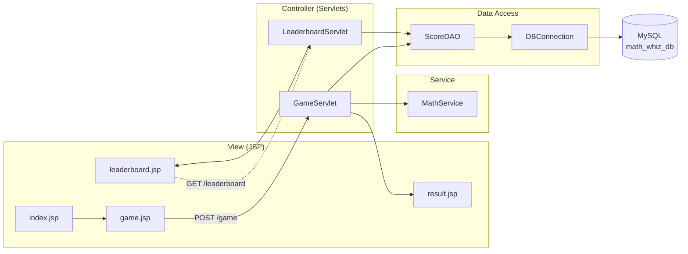
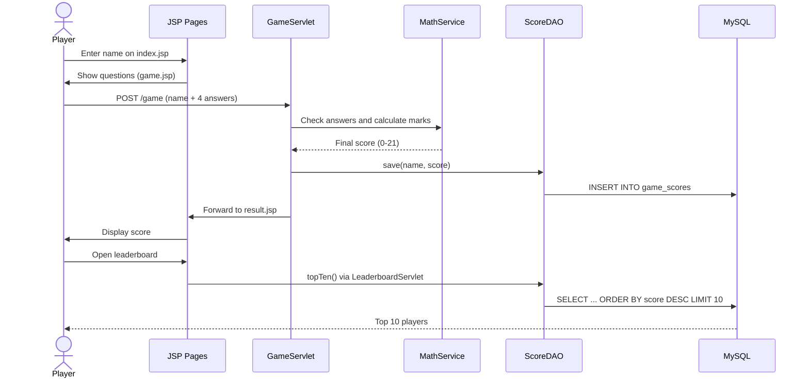
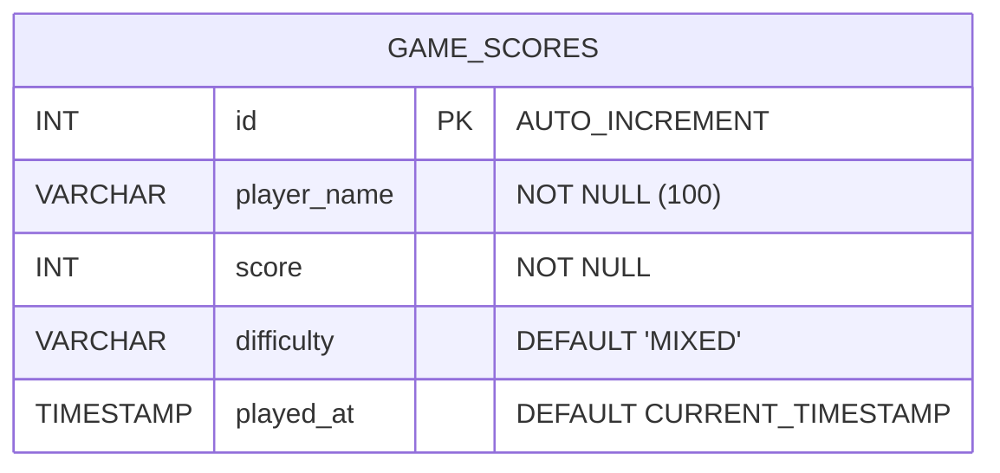

<div align="center">

# 🧮 Math Whiz

**A Java Servlet & JSP quiz application that tests prime numbers, modulus and trigonometry — with difficulty-based scoring and a MySQL-backed leaderboard.**


</div>

---

## 📑 Table of Contents

- [Overview](#-overview)
- [Features](#-features)
- [Screenshots](#-screenshots)
- [Tech Stack](#-tech-stack)
- [Architecture](#-architecture)
- [Database Design](#-database-design)
- [Scoring System](#-scoring-system)
- [Project Structure](#-project-structure)
- [Getting Started](#-getting-started)
- [Application Routes](#-application-routes)
- [Source Code Highlights](#-source-code-highlights)
- [Troubleshooting](#-troubleshooting)
- [Future Improvements](#-future-improvements)
- [Author](#-author)

---

## 📖 Overview

**Math Whiz** is a web-based math quiz built with classic Java web technologies. A player enters their name, answers four questions of mixed difficulty, receives an instant score out of **21**, and the result is saved to a MySQL database. The **Top 10 leaderboard** shows the best players of all time.

The project follows a clean layered structure (**Controller → Service → DAO → Database**) and uses plain **JDBC** with `PreparedStatement`, making it a good reference for learning the fundamentals of Java EE / Jakarta EE web development.

## ✨ Features

- 🎯 **Four questions** covering prime numbers, modulus and trigonometry
- ⚖️ **Difficulty-based scoring** — Easy ×1, Normal ×2, Hard ×3
- 🏆 **Top 10 leaderboard** ranked by score, then by earliest play time
- 💾 **Persistent storage** of every game result using JDBC and MySQL
- 🔐 **SQL injection safe** — all queries use `PreparedStatement`
- 🛡️ **XSS-safe output** — player names are HTML-escaped before rendering
- 📐 **Floating-point tolerant** answer checking for trigonometric values
- 📱 **Responsive UI** built with plain HTML and CSS

## 📸 Screenshots

### Quiz Page
<p align="center">
  
</p>

### Result Page
<p align="center">
  
</p>

### Leaderboard
<p align="center">
  
</p>

## 🛠 Tech Stack

| Layer | Technology |
|---|---|
| Language | Java 21 |
| Web | Jakarta Servlet 6.0, JSP |
| Server | Apache Tomcat 10.1+ |
| Database | MySQL 8+ |
| Data access | JDBC (MySQL Connector/J 9.3.0) |
| Build tool | Apache Maven (WAR packaging) |
| Frontend | HTML5, CSS3 |

## 🏗 Architecture

The application follows a layered MVC-style design.



### Game Flow



## 🗄 Database Design



```sql
CREATE DATABASE IF NOT EXISTS math_whiz_db
  CHARACTER SET utf8mb4 COLLATE utf8mb4_unicode_ci;
USE math_whiz_db;

CREATE TABLE IF NOT EXISTS game_scores (
    id          INT PRIMARY KEY AUTO_INCREMENT,
    player_name VARCHAR(100) NOT NULL,
    score       INT NOT NULL,
    difficulty  VARCHAR(20) NOT NULL DEFAULT 'MIXED',
    played_at   TIMESTAMP NOT NULL DEFAULT CURRENT_TIMESTAMP
);
```

## 🧾 Scoring System

**Final marks = Base marks × Difficulty multiplier.** A wrong answer scores 0.

| # | Topic | Question | Base | Difficulty | Multiplier | Max |
|:-:|---|---|:-:|:-:|:-:|:-:|
| 1 | Prime number | Is 7 a prime number? | 2 | EASY | ×1 | **2** |
| 2 | Modulus | 17 % 5 = ? | 2 | NORMAL | ×2 | **4** |
| 3 | Trigonometry | sin(30°) = ? | 3 | HARD | ×3 | **9** |
| 4 | Trigonometry | tan(45°) = ? | 3 | NORMAL | ×2 | **6** |
| | | **Total** | **10** | | | **21** |

## 📁 Project Structure

```
MathWhiz/
├── database/
│   └── math_whiz_db.sql              # Database schema
├── docs/
│   └── screenshots/                  # README images
├── src/main/
│   ├── java/com/shawon/mathwhiz/
│   │   ├── controller/
│   │   │   ├── GameServlet.java          # Game flow & score calculation
│   │   │   └── LeaderboardServlet.java   # Top 10 leaderboard
│   │   ├── service/
│   │   │   └── MathService.java          # Math logic & answer checking
│   │   ├── dao/
│   │   │   ├── DBConnection.java         # JDBC connection
│   │   │   └── ScoreDAO.java             # Insert & leaderboard queries
│   │   └── model/
│   │       └── GameScore.java            # Score entity
│   └── webapp/
│       ├── css/style.css
│       ├── WEB-INF/web.xml
│       ├── index.jsp                     # Welcome page
│       ├── game.jsp                      # Quiz page
│       ├── result.jsp                    # Result page
│       └── leaderboard.jsp               # Leaderboard page
├── pom.xml
└── README.md
```

## 🚀 Getting Started

### Prerequisites

- JDK 21 or later
- Apache Maven 3.9+
- Apache Tomcat 10.1+ (**Tomcat 9 or older will not work** — this project uses `jakarta.*` packages)
- MySQL 8+

### Installation

**1. Clone the repository**

```bash
git clone https://github.com/<your-username>/MathWhiz.git
cd MathWhiz
```

**2. Create the database**

Run `database/math_whiz_db.sql` in MySQL Workbench or the MySQL CLI:

```bash
mysql -u root -p < database/math_whiz_db.sql
```

**3. Configure database credentials**

Open `src/main/java/com/shawon/mathwhiz/dao/DBConnection.java` and update:

```java
private static final String USER     = "your_mysql_username";
private static final String PASSWORD = "your_mysql_password";
```

> ⚠️ Never commit real passwords to a public repository.

**4. Build the project**

```bash
mvn clean package
```

**5. Deploy to Tomcat**

Copy `target/MathWhiz.war` into Tomcat's `webapps/` folder and start Tomcat.
Alternatively, run it from IntelliJ IDEA with a Tomcat run configuration and set the **Application context** to `/MathWhiz`.

**6. Open the application**

```
http://localhost:8080/MathWhiz/
```

## 🌐 Application Routes

| Method | URL | Description |
|:-:|---|---|
| GET | `/` or `/index.jsp` | Welcome page |
| GET | `/game.jsp?playerName=...` | Quiz page |
| POST | `/game` | Submit answers, calculate and save the score |
| GET | `/leaderboard` | Top 10 leaderboard |

## 💻 Source Code Highlights

### Answer checking and scoring — `GameServlet`

```java
int score = 0;

// Q1: Prime number - EASY
if (q1 == MathService.isPrime(7)) {
    score += MathService.calculateFinalMarks(2, "EASY");
}

// Q2: Modulus - NORMAL
if (q2 == MathService.calculateMod(17, 5)) {
    score += MathService.calculateFinalMarks(2, "NORMAL");
}

// Q3: Sine - HARD
if (MathService.isClose(q3, MathService.calculateSin(30))) {
    score += MathService.calculateFinalMarks(3, "HARD");
}

// Q4: Tangent - NORMAL
if (MathService.isClose(q4, MathService.calculateTan(45))) {
    score += MathService.calculateFinalMarks(3, "NORMAL");
}

new ScoreDAO().save(playerName.trim(), score);
```

### Math logic — `MathService`

```java
// Trigonometry works in degrees
public static double calculateSin(double degree) {
    return Math.sin(Math.toRadians(degree));
}

// Decimal answers are compared with a tolerance
public static boolean isClose(double actual, double answer) {
    return Math.abs(actual - answer) <= 0.0001;
}

// Difficulty multiplier
public static int getMultiplier(String difficulty) {
    return switch (difficulty.toUpperCase()) {
        case "EASY"   -> 1;
        case "NORMAL" -> 2;
        case "HARD"   -> 3;
        default -> throw new IllegalArgumentException("Invalid difficulty level");
    };
}
```

### Database access — `ScoreDAO`

```java
public List<GameScore> topTen() throws SQLException {
    String sql = """
            SELECT id, player_name, score, difficulty, played_at
            FROM game_scores
            ORDER BY score DESC, played_at ASC
            LIMIT 10
            """;
    // PreparedStatement + try-with-resources
}
```

## 🩺 Troubleshooting

| Problem | Likely cause and fix |
|---|---|
| **404 – `/MathWhiz/` is not available** | The app failed to deploy. Check `logs/localhost.*.log` in Tomcat. Make sure `web.xml` starts with `<?xml` as the very first character (no blank line before it) and that the context path is `/MathWhiz`. |
| **`Table 'math_whiz_db.game_scores' doesn't exist`** | The database script has not been run. Execute `database/math_whiz_db.sql`. |
| **`Access denied for user`** | Wrong MySQL username or password in `DBConnection.java`. |
| **`ClassNotFoundException: javax.servlet...`** | You are using Tomcat 9 or older. Use Tomcat 10.1+. |
| **`UnsupportedClassVersionError`** | Tomcat is running on a JDK older than 21. Use JDK 21+. |

## 🔮 Future Improvements

- [ ] Randomly generated questions from a question bank
- [ ] User accounts and login
- [ ] Store database credentials in environment variables
- [ ] Redirect-after-POST to prevent duplicate score submissions
- [ ] Per-question feedback and explanations
- [ ] Unit tests for `MathService` with JUnit 5
- [ ] Docker Compose setup for Tomcat + MySQL

## 👤 Author

**MD Shawon Ali**

If you found this project useful, consider giving it a ⭐.

## 📄 License

This project is created for educational purposes. Add a license of your choice (for example MIT) before publishing.
