# ReliefTrace: An Offline-First, RFID-Enabled Relief Distribution Management System

**Software Engineering Project Assignment: Design and Implementation Plan**

> **Status of this document.** This is a *design and implementation plan*. It does **not** claim that the complete system exists or that any system-level test has been passed. The only items that have been built and checked are listed explicitly in [Section 11.7](#117-what-has-and-has-not-been-verified). Items marked **(Assumption)** or **(Proposed)** are decisions made for this project that the student or the course teacher may change.

---

## 1. Title Page

| Field | Entry |
|---|---|
| **Project title** | ReliefTrace: An Offline-First, RFID-Enabled Relief Distribution Management System |
| **Course title and code** | `[Software Engineering, course code]` |
| **Assignment** | Individual Software Engineering Project |
| **Student name** | Shawon `[confirm full name as it appears in university records]` |
| **Student ID** | IT24051 |
| **Department** | Department of Information and Communication Technology |
| **University** | Mawlana Bhashani Science and Technology University (MBSTU), Bangladesh |
| **Submitted to** | `[Course teacher name and designation]` |
| **Date of submission** | `[DD Month YYYY]` |
| **GitHub repository** | `[paste your repository URL after you create it]` |

---

## 2. Table of Contents

1. [Title Page](#1-title-page)
2. [Table of Contents](#2-table-of-contents)
3. [Introduction](#3-introduction)
4. [Problem Statement and Motivation](#4-problem-statement-and-motivation)
5. [Objectives and Scope](#5-objectives-and-scope)
6. [Requirements Specification](#6-requirements-specification)
7. [Process Model and Methodology](#7-process-model-and-methodology)
8. [System Architecture](#8-system-architecture)
9. [Project Schedule, Milestones, Deliverables, and Gantt Chart](#9-project-schedule-milestones-deliverables-and-gantt-chart)
10. [The Six Diagrams](#10-the-six-diagrams)
11. [GUI Design and Five-Class Mapping](#11-gui-design-and-five-class-mapping)
12. [Database and Hardware Design](#12-database-and-hardware-design)
13. [Testing and Quality Assurance](#13-testing-and-quality-assurance)
14. [Risk, Security, Privacy, and Limitations](#14-risk-security-privacy-and-limitations)
15. [GitHub Repository and Submission Plan](#15-github-repository-and-submission-plan)
16. [Conclusion](#16-conclusion)
17. [References](#17-references)
- [Appendix A: Full SQLite Schema](#appendix-a-full-sqlite-schema)
- [Appendix B: ESP32 Sketch](#appendix-b-esp32-sketch)
- [Appendix C: LaTeX-Ready Structure](#appendix-c-latex-ready-structure)
- [Appendix D: How to Render the Diagrams](#appendix-d-how-to-render-the-diagrams)
- [Final Compliance Checklist](#final-compliance-checklist)

---

## 3. Introduction

After floods, cyclones, or river erosion, relief centres must hand out food, water, and shelter items quickly. Paper registers and hand-counted stock make it hard to answer three basic questions: *Who has already received help in this round? What is left in stock? Can the records be trusted afterwards?*

**ReliefTrace** is a Windows desktop application that helps authorised personnel at a relief centre register affected households, identify them (by RFID card or by manual search), recommend relief quantities using transparent rules, record each handover after human approval, keep stock consistent, and keep an audit trail whose integrity can be checked. It works **fully offline** on one computer and needs no smartphone or internet access for affected citizens.

### 3.1 Technology summary

| Part | Choice |
|---|---|
| Application | Java desktop application, Swing GUI |
| Storage | SQLite file on the local machine |
| Hardware | ESP32 board + RC522 RFID reader + RFID cards, connected by USB Serial |
| Integrity | SHA-256 hash chain over audit records |
| Platform | Windows 10/11 (Java 17 or later) **(Assumption)** |

### 3.2 What this assignment contains

A project proposal, a process model, an eight-week schedule with Gantt chart, six UML/DFD/ER diagrams, a GUI design with a class mapping, database and hardware design, a test plan, risk analysis, and a GitHub submission plan. An **optional** small Java Swing prototype accompanies it in the repository (see [Section 11.6](#116-optional-implementation-sample-separate-from-the-design)).

### 3.3 Important honesty notes

- An RFID card UID is an *identifier*, not secure authentication. UIDs can be copied on some card types. Therefore **a human must approve every distribution**.
- A hash chain can *help detect* later modification of recorded data. It **cannot** prove the original data was true, and it cannot prove the allocation decision was fair.
- The system supports good record-keeping. It does not guarantee fairness and does not eliminate fraud.

### 3.4 Source materials and reconciliation

| Item | Status |
|---|---|
| Official assignment sheet | **Not supplied.** The ten requirements from the request were used as the authority. If your teacher's sheet differs (page limits, format, mandatory tools, naming), follow the sheet and adjust. |
| Initial proposal | Not supplied separately. Section 4 to 6 act as the proposal. The finalized scope in the request was **not changed**. |
| Conflicts found | None between the request items. One clarification: Mermaid cannot draw Use Case, Activity, or Object diagrams in true UML notation. For these three, PlantUML source (accurate UML) **and** a Mermaid approximation (renders directly on GitHub) are both given. |

---

## 4. Problem Statement and Motivation

**Problem.** Relief centres in disaster conditions often have unreliable electricity and internet. Manual registers create several recurring problems:

1. **Duplicate distribution** in one round, and the opposite problem of eligible households being missed.
2. **Stock mismatch** between what the register says was given and what is physically left.
3. **Slow identification** of households in long queues.
4. **Weak accountability**: records can be altered afterwards and nobody can show that they were not.
5. **Opaque quantities**: households and volunteers cannot see why a household received a given amount.

**Motivation.** A small, offline, low-cost system can reduce these problems without requiring affected people to own phones. RFID cards give fast identification; rule-based recommendations make quantities explainable; transactional stock updates keep inventory consistent; and a hash-chained audit log makes silent editing detectable.

**Why this suits a student project.** It combines database design, object-oriented design, GUI work, a small hardware interface, and a clear security idea (hash chaining) while staying implementable by one person in two months. No claim is made that no similar system exists.

---

## 5. Objectives and Scope

### 5.1 Objectives

| ID | Objective |
|---|---|
| O1 | Register households and manage their profiles offline. |
| O2 | Associate one active RFID card with a household and identify households by card UID. |
| O3 | Provide manual household lookup whenever the reader or card is unavailable. |
| O4 | Manage relief items and stock with a transaction ledger. |
| O5 | Produce explainable, rule-based allocation proposals for a distribution round. |
| O6 | Record distributions only after human approval, prevent duplicates within a round, and reduce stock transactionally. |
| O7 | Keep a hash-chained audit trail and provide a verification function. |
| O8 | Provide summary reports and local database backup. |
| O9 | Deliver a documented, tested, GitHub-hosted project within eight weeks. |

### 5.2 In scope

Single-computer Windows application; Java Swing GUI; SQLite; ESP32 + RC522 over USB Serial; three roles (Coordinator, Volunteer, Auditor); synthetic test data; manual backup.

### 5.3 Out of scope (explicitly)

Internet or cloud sync; multi-computer networking; mobile apps; biometric identification; payment; GPS mapping; automatic eligibility *decisions* (the system only recommends; people decide); legal or policy determination of who is eligible; database encryption (listed as future work); production deployment with real disaster-victim data.

### 5.4 Assumptions

| ID | Assumption |
|---|---|
| A1 | One relief-centre computer runs the application; one reader is attached. |
| A2 | Allocation rules (Section 6.3) are illustrative **(Assumption)**; a real centre would set its own rules. |
| A3 | RFID cards will be tested for RC522 compatibility **before** being relied on. The card type is not assumed. |
| A4 | Quantities are whole numbers (kg, bottles, pieces, packs). |
| A5 | Only synthetic data is used for development, testing, and demonstration. |

---

## 6. Requirements Specification

### 6.1 Roles and permissions

| Function | Coordinator | Volunteer | Auditor |
|---|:---:|:---:|:---:|
| Log in (role-based access) | Yes | Yes | Yes |
| Register / edit household | Yes | Yes | No |
| Search household (manual) | Yes | Yes | Read-only |
| Assign RFID card | Yes | Yes | No |
| Revoke / replace card | Yes | No | No |
| Manage relief items and receive stock | Yes | No (view only) | No (view only) |
| Create / open / close distribution round | Yes | No | No |
| Generate and review allocation proposals | Yes | Yes | No |
| Approve and record distribution | Yes | Yes | No |
| View and export reports | Yes | Summary only **(Assumption)** | Yes |
| Verify audit chain / view audit log | Yes | No | Yes |
| Back up database | Yes | No | No |

### 6.2 Functional requirements

| ID | Requirement | Priority |
|---|---|---|
| FR-01 | The system shall require login; each user has exactly one role; passwords are stored as salted hashes. | Must |
| FR-02 | The system shall register a household with code, head name, area, member count, children under 5, elderly count, damage level. | Must |
| FR-03 | The system shall validate household data (member count 1 to 30; children + elderly not above members; required fields). | Must |
| FR-04 | The system shall search households by code, head name, or area. | Must |
| FR-05 | The system shall allow a household to be marked inactive instead of deleted. | Should |
| FR-06 | The system shall assign a card UID to a household; one UID maps to one household; at most one ACTIVE card per household. | Must |
| FR-07 | The system shall revoke a card (REVOKED or LOST) and allow a replacement. | Should |
| FR-08 | The system shall identify a household from a card UID received over USB Serial. | Must |
| FR-09 | The system shall provide manual lookup when the reader is unavailable or the card is unknown, and shall record the input method. | Must |
| FR-10 | The system shall maintain relief items and stock; receiving stock creates a ledger entry. | Must |
| FR-11 | The system shall flag items at or below a low-stock threshold. | Should |
| FR-12 | The system shall create, open, and close distribution rounds. | Must |
| FR-13 | The system shall propose quantities per item using the rules in 6.3 and show a text explanation for each. | Must |
| FR-14 | The system shall limit a proposed quantity to current stock and say so in the explanation. | Must |
| FR-15 | The system shall not create a second allocation for the same household, item, and round. | Must |
| FR-16 | The system shall record a distribution only after explicit approval by a Coordinator or Volunteer. | Must |
| FR-17 | The system shall allow rejection of a proposal with a mandatory reason. | Must |
| FR-18 | On approval, the system shall reduce stock, record the distribution, write a ledger entry, update the allocation status, and append an audit record **in one transaction**. | Must |
| FR-19 | The system shall append an audit record for every state-changing event and for blocked duplicates. | Must |
| FR-20 | The system shall verify the audit hash chain and report the first broken sequence number. | Must |
| FR-21 | The system shall show summary reports (distribution totals per round and item, stock status, households not yet served in a round) and export CSV. | Should |
| FR-22 | The system shall copy the database file to a backup location on request. | Should |

### 6.3 Allocation rules (Assumption, illustrative)

| Rule | Item | Quantity |
|---|---|---|
| R1 | Rice (kg) | 2 x members |
| R2 | Drinking Water (bottles) | 3 x members |
| R3 | Blanket (pieces) | ceil(members / 2) |
| R4 | Baby Food Pack | 1 x children under 5 (only if above 0) |
| R5 | Stock limit | quantity = min(rule quantity, stock on hand) |

Each proposal stores a plain-text explanation, for example: `R1: 2 kg x 5 members = 10`.

### 6.4 Non-functional requirements

| ID | Requirement | How measured |
|---|---|---|
| NFR-01 | **Offline operation**: all features work with the network disabled. | Test T-OFF-01 |
| NFR-02 | **Data integrity**: stock never negative; no duplicate distribution per allocation. | Tests T-DUP, T-STK |
| NFR-03 | **Responsiveness (target)**: household lookup shows a result within 1 second for 5,000 synthetic households on the development PC. | Timed test; *target, not a result* |
| NFR-04 | **Usability**: a new volunteer completes a distribution in under 2 minutes after a 5-minute walkthrough **(target)**. | Informal trial with a classmate |
| NFR-05 | **Security**: role checks in the service layer; no plain-text passwords; no real personal data in the repository. | Code review + checklist |
| NFR-06 | **Maintainability**: layered packages; each class has one clear responsibility; basic Java OOP only. | Review against Section 11 |
| NFR-07 | **Portability**: runs on Windows 10/11 with Java 17+. | Run on a second PC if available |

---

## 7. Process Model and Methodology

### 7.1 Chosen model: Iterative and Incremental

Work is delivered in small **increments**. Each increment adds a usable slice, is tested, and its feedback shapes the next one.

### 7.2 Why it fits an individual student project

1. **Requirements are mostly known but details will change** (for example, screen layout, rules). Iteration allows cheap correction.
2. **One developer, limited hours.** Short increments give frequent, visible progress and natural stopping points.
3. **Hardware is risky.** The RFID increment can be placed *after* a working manual version, so a hardware delay cannot block the minimum viable product (MVP).
4. **Early feedback is possible** from the course teacher and a classmate acting as a volunteer.
5. A heavy plan-driven model (such as pure Waterfall) would lock the design before the card reader has been tried on real cards.

### 7.3 Increments

| Increment | Weeks | Content | Result |
|---|---|---|---|
| I0 Plan | 1 | Proposal, requirements, ERD and schema, repository, hardware bench spike | Baseline documents |
| I1 Data screens | 2 to 3 | Swing shell, household registration/search, stock management, rounds | Data screens work |
| I2 Core workflow | 4 | Allocation rules, approval, transactional distribution, duplicate check | **MVP (manual mode)** |
| I3 Trust | 5 | Audit hash chain, verification, reports, backup | Auditable MVP |
| I4 Hardware | 6 | Serial protocol, `RfidSerialService`, scan on Distribution screen, fallback | RFID mode |
| I5 Quality | 7 | Full test plan, defect fixing, buffer | Tested build |
| I6 Finish | 8 | Final diagrams, screenshots, README, demo, submission | Submission package |

### 7.4 Feedback and testing within each increment

- Each increment ends with a **demo to self** using synthetic data and a short checklist (done, tested, committed).
- Unit-level checks are written for the service classes as they are built (duplicate, stock, hash chain).
- A **classmate or teacher walkthrough** after I2 and after I4 collects usability feedback; changes go to a short "backlog" list for the next increment.
- Defects found are logged in the GitHub Issues list and fixed in I5 at the latest.

### 7.5 Protecting the minimum working version from hardware delay

| Protection | Detail |
|---|---|
| Order of work | Manual mode (I2) is complete **before** serial work (I4). |
| Early hardware spike | A 2-hour, time-boxed bench test in Week 1 to 2 checks that the RC522 reads the available cards and shows a UID in the Arduino Serial Monitor. |
| Fallback is a feature | Manual search is a required function (FR-09), so the demo works without the reader. |
| Simulated scan | The Distribution screen has a "Simulate card scan" box, so serial parsing and UI can be tested without hardware. |
| Buffer | Week 7 contains slack; Week 6 can slip into Week 7 without breaking the MVP. |

---

## 8. System Architecture

### 8.1 Layered architecture

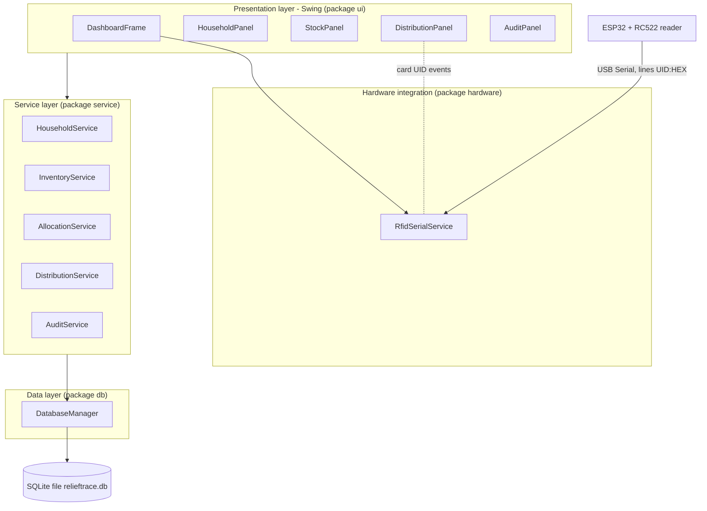

### 8.2 Design principles

- **Separation of concerns.** UI classes never run SQL; they call services. Services enforce roles and business rules; `DatabaseManager` owns connections and transactions.
- **Models are plain Java objects** (`Household`, `Allocation`, and so on).
- **Hardware is isolated** behind `RfidSerialService` and the `CardScanListener` interface, so the app runs without it.
- **Single writer.** One application instance owns the SQLite file.

### 8.3 Technology stack

| Purpose | Technology |
|---|---|
| Language / GUI | Java 17+, Swing |
| Build | Maven (recommended) or plain `javac` for the prototype |
| Database | SQLite via the `sqlite-jdbc` library |
| Serial | `jSerialComm` library (or equivalent) |
| Microcontroller | ESP32 programmed in Arduino C++ with the `MFRC522` library |
| Hashing | `java.security.MessageDigest` (SHA-256) |
| Version control | Git and GitHub |

> Check current library versions on their official pages before adding them to `pom.xml`. No version numbers are asserted here.

---

## 9. Project Schedule, Milestones, Deliverables, and Gantt Chart

**Effort budget (Assumption).** 1 to 2 hours per day for 8 weeks is roughly 56 to 112 hours in total, or 7 to 14 hours per week. The plan is sized for the lower end and treats the upper end as buffer. The start date (Monday 2 November 2026) is editable.

### 9.1 Gantt chart

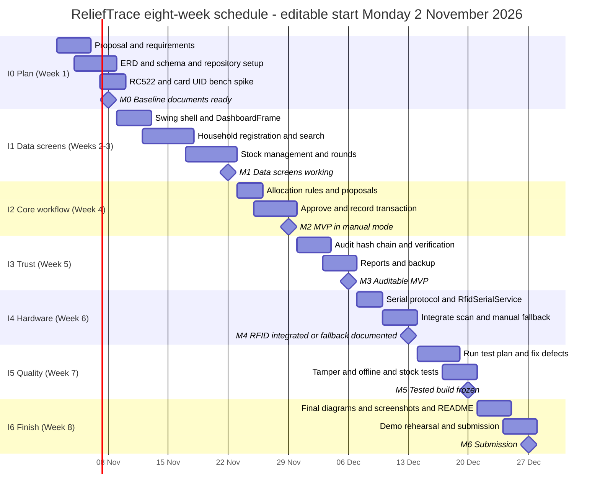

### 9.2 Milestones and deliverables

| Milestone | Target date | Deliverables | Completion evidence |
|---|---|---|---|
| **M0** Baseline | 8 Nov 2026 | Proposal, requirements, ERD, `schema.sql`, repository with README stub, hardware spike note | Files committed; spike note says which cards read |
| **M1** Data screens | 22 Nov 2026 | Household, stock, round screens working on SQLite | Screenshots; manual test of FR-02 to FR-12 |
| **M2** MVP (manual) | 29 Nov 2026 | Proposals, approval, transactional distribution, duplicate block | Demo of end-to-end flow without reader; tag `v0.2-mvp` |
| **M3** Auditable MVP | 6 Dec 2026 | Hash chain, verify button, reports, backup | Tamper demo works |
| **M4** RFID | 13 Dec 2026 | ESP32 sketch, serial service, scan-to-household | Video/screenshots, or documented fallback if hardware fails |
| **M5** Tested build | 20 Dec 2026 | Test results table, defect list, frozen release | Completed Section 13 tables with real results |
| **M6** Submission | 27 Dec 2026 | Final report (PDF + Markdown), repository link, demo | Submission checklist ticked |

> The dates assume the stated start. Shift all dates together if your submission deadline differs.

---

## 10. The Six Diagrams

All six diagrams describe the **same system** and use the same names for entities, processes, and classes. A consistency table appears in [10.7](#107-consistency-check-across-diagrams).

**Notation notes.**
- *DFD*: circles are processes, open cylinders are data stores, rectangles are external entities; arrows are **named data flows**, not control flow. Mermaid has no DFD shape set, so this is its flowchart syntax with DFD conventions.
- *Use Case, Activity, Object*: Mermaid cannot draw true UML for these. **PlantUML** source (accurate UML) is given, plus a **Mermaid approximation** that renders directly on GitHub. See [Appendix D](#appendix-d-how-to-render-the-diagrams).
- *ERD and Class Diagram*: native Mermaid (`erDiagram`, `classDiagram`).

### 10.A Data Flow Diagrams

#### A.1 Context Diagram (Level 0)

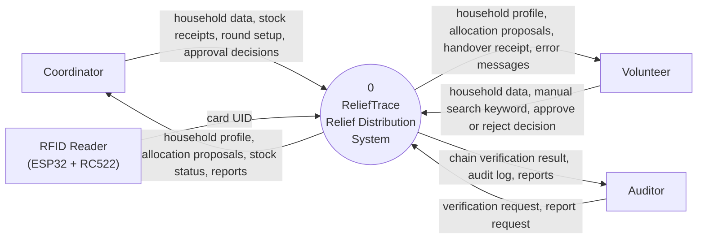

#### A.2 Level-1 DFD

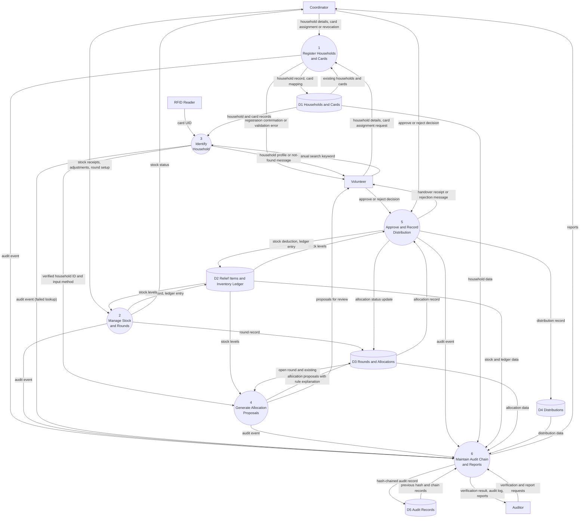

*Notes.* Login/authentication is a cross-cutting check performed before each process and is omitted from Level 1 for readability. Data flows never connect two stores directly or an external entity directly to a store, following standard DFD rules.

---

### 10.B Use Case Diagram

**Use cases:** UC1 Register Household; UC2 Search Household Manually; UC3 Identify Household by RFID Scan; UC4 Assign RFID Card; UC5 Revoke or Replace RFID Card; UC6 Manage Relief Stock; UC7 Manage Distribution Round; UC8 Review Allocation Proposal; UC9 Approve and Record Distribution; UC10 View and Export Reports; UC11 Verify Audit Chain; UC12 Back Up Database.

**Relationships:** UC8 *includes* UC3 (a household must be identified); UC2 *extends* UC3 (when the reader or card is unavailable); UC9 *includes* UC8 (approval follows review). Actor permissions match [Section 6.1](#61-roles-and-permissions).

#### PlantUML (accurate UML)

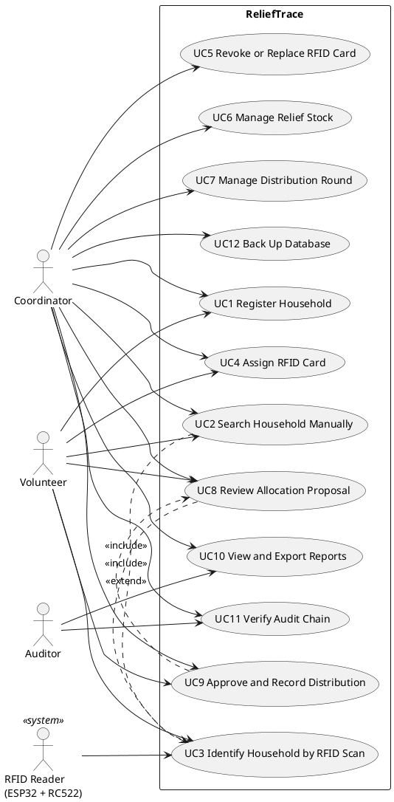

#### Mermaid approximation (renders on GitHub)

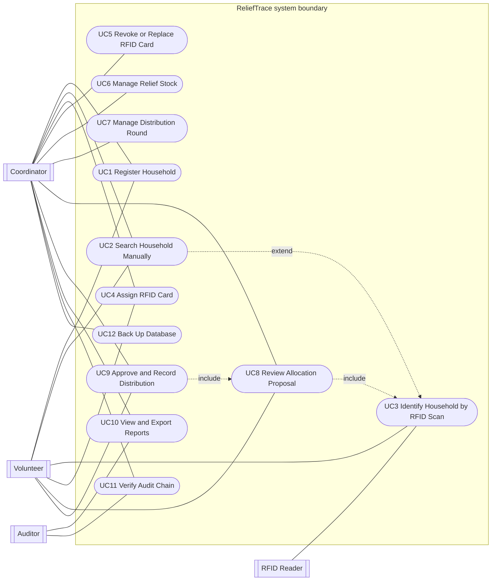

---

### 10.C Activity Diagram

The workflow covers: identification (scan or manual), household validation, round check, duplicate check, proposal, stock check, human approval, transactional recording, and audit logging, with failure and rejection branches.

#### PlantUML (accurate UML)

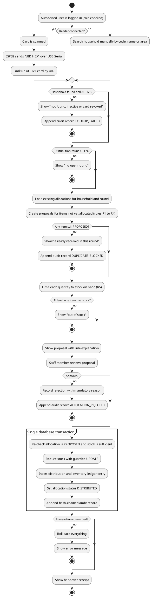

#### Mermaid approximation (renders on GitHub)

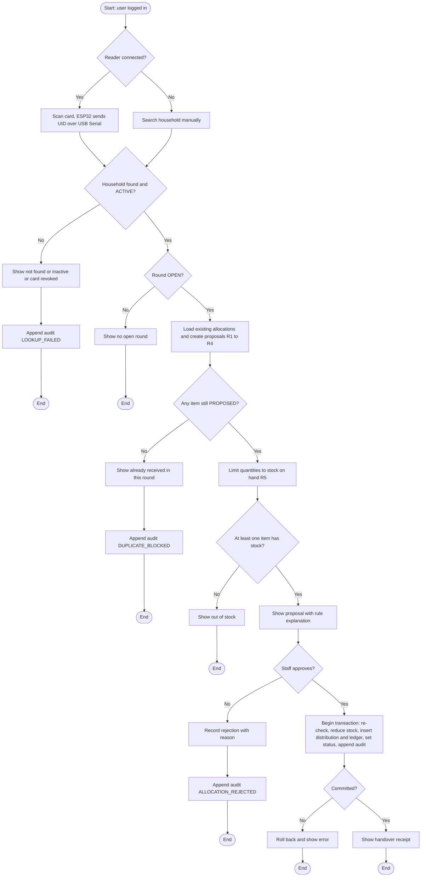

---

### 10.D Entity-Relationship Diagram

**Entities (9):** `APP_USER`, `HOUSEHOLD`, `RFID_CARD`, `RELIEF_ITEM`, `INVENTORY_TRANSACTION`, `DISTRIBUTION_ROUND`, `ALLOCATION`, `DISTRIBUTION`, `AUDIT_RECORD`. `StockBatch` was deliberately **not** used: a single `quantity_on_hand` with a ledger (`INVENTORY_TRANSACTION`) is simpler for one developer and still keeps stock auditable.

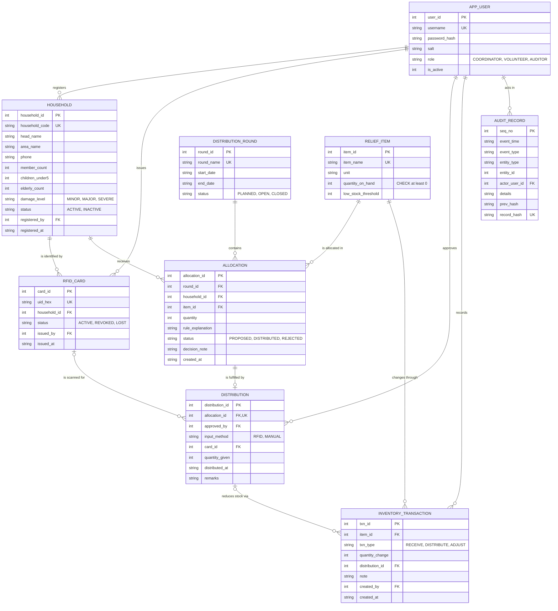

**Cardinalities in words**

| Relationship | Cardinality | Meaning |
|---|---|---|
| Household to RfidCard | 1 : 0..* | A household may have several cards over time, but only one ACTIVE (partial unique index). |
| DistributionRound to Allocation | 1 : 0..* | A round contains many allocations. |
| Household to Allocation | 1 : 0..* | A household has at most one allocation per item per round. |
| ReliefItem to Allocation | 1 : 0..* | An item appears in many allocations. |
| Allocation to Distribution | 1 : 0..1 | An allocation is fulfilled at most once. |
| RfidCard to Distribution | 0..1 : 0..* | A distribution records the card scanned, if any. Manual lookups have none. |
| ReliefItem to InventoryTransaction | 1 : 0..* | Every stock change is a ledger row. |
| Distribution to InventoryTransaction | 0..1 : 0..* | A DISTRIBUTE ledger row points to its distribution. |

**Design features that prevent bad data**

- `UNIQUE(round_id, household_id, item_id)` on `allocation`, plus `UNIQUE(allocation_id)` on `distribution`: duplicates are rejected by the database itself, not just by Java code.
- `CHECK (quantity_on_hand >= 0)` and a guarded `UPDATE`: stock cannot go negative.
- Partial unique index on active cards; `CHECK` on the UID format (8, 14, or 20 hex characters for 4-, 7-, or 10-byte UIDs).
- `CHECK` that `DISTRIBUTE` ledger rows have a distribution and other rows do not.
- Triggers that block updates or deletes on `audit_record` and distributions on non-PROPOSED allocations (defence in depth; see 12.1).

---

### 10.E Class Diagram

The design has **23 classes, enumerations and interfaces** in six groups, each justified by the GUI or the database. Foreign-key attributes are shown as **associations** rather than repeated attributes. Group stereotypes: `entity`, `service`, `repository`, `hardware`, `ui`, `result`.

```mermaid
classDiagram
    direction TB

    class Role {
        <<enumeration>>
        COORDINATOR
        VOLUNTEER
        AUDITOR
    }
    class User {
        <<entity>>
        -int userId
        -String username
        -Role role
        +canApproveDistribution() boolean
        +canRegisterHouseholds() boolean
        +canManageStock() boolean
    }
    class Household {
        <<entity>>
        -int householdId
        -String householdCode
        -String headName
        -String areaName
        -int memberCount
        -int childrenUnder5
        -int elderlyCount
        -String damageLevel
        -String status
        +isActive() boolean
    }
    class RfidCard {
        <<entity>>
        -int cardId
        -String uidHex
        -String status
        +isActive() boolean
    }
    class ReliefItem {
        <<entity>>
        -int itemId
        -String itemName
        -String unit
        -int quantityOnHand
        -int lowStockThreshold
        +isLowStock() boolean
        +increase(int qty) void
        +decrease(int qty) void
    }
    class DistributionRound {
        <<entity>>
        -int roundId
        -String roundName
        -LocalDate startDate
        -LocalDate endDate
        -String status
        +isOpen() boolean
    }
    class Allocation {
        <<entity>>
        -int allocationId
        -int quantity
        -String ruleExplanation
        -Status status
        -String decisionNote
        +isProposed() boolean
        +setStatus(Status s, String note) void
    }
    class Distribution {
        <<entity>>
        -int distributionId
        -String inputMethod
        -int quantityGiven
        -Instant distributedAt
        -String remarks
    }
    class AuditRecord {
        <<entity>>
        -int seqNo
        -String eventTime
        -String eventType
        -String entityType
        -int entityId
        -String details
        -String prevHash
        -String recordHash
    }

    class DatabaseManager {
        <<repository>>
        +getConnection() Connection
        +initializeSchema() void
        +beginTransaction() void
        +commit() void
        +rollback() void
        +backupTo(String path) void
    }

    class HouseholdService {
        <<service>>
        +register(String head, String area, int members, int under5, int elderly, String damage, User actor) Household
        +search(String keyword) List~Household~
        +findByCardUid(String uidHex) Household
        +assignCard(int householdId, String uidHex, User actor) RfidCard
        +revokeCard(int cardId, String reason, User actor) void
    }
    class InventoryService {
        <<service>>
        +listItems() List~ReliefItem~
        +receiveStock(int itemId, int qty, User actor) void
        +adjustStock(int itemId, int delta, String note, User actor) void
    }
    class AllocationService {
        <<service>>
        +generateProposals(int householdId, int roundId, User actor) List~Allocation~
        +findFor(int householdId, int roundId) List~Allocation~
    }
    class DistributionService {
        <<service>>
        +approveAndRecord(int allocationId, String inputMethod, String cardUid, User actor) Distribution
        +rejectAllocation(int allocationId, String reason, User actor) void
    }
    class AuditService {
        <<service>>
        +append(String eventType, String entityType, int entityId, String details, User actor) AuditRecord
        +verifyChain() VerificationResult
        +listAll() List~AuditRecord~
    }
    class VerificationResult {
        <<result>>
        -boolean valid
        -int brokenAtSeq
        -String message
        +isValid() boolean
    }

    class CardScanListener {
        <<interface>>
        +onCardScanned(String uidHex) void
    }
    class RfidSerialService {
        <<hardware>>
        -boolean connected
        +connect(String portName) boolean
        +disconnect() void
        +setListener(CardScanListener l) void
        +handleLine(String line) void
    }

    class DashboardFrame {
        <<ui>>
        +refreshAll() void
    }
    class HouseholdPanel {
        <<ui>>
        +refresh() void
    }
    class StockPanel {
        <<ui>>
        +refresh() void
    }
    class DistributionPanel {
        <<ui>>
        +onCardScanned(String uidHex) void
        +refresh() void
    }
    class AuditPanel {
        <<ui>>
        +refresh() void
    }

    User --> Role
    Household "1" --> "0..*" RfidCard : identified by
    Allocation "*" --> "1" Household : for
    Allocation "*" --> "1" DistributionRound : in
    Allocation "*" --> "1" ReliefItem : of
    Allocation "1" --> "0..1" Distribution : fulfilled by
    Distribution "*" --> "1" User : approved by
    Distribution "*" --> "0..1" RfidCard : scanned card
    AuditRecord "*" --> "0..1" User : actor

    HouseholdService ..> Household
    HouseholdService ..> RfidCard
    InventoryService ..> ReliefItem
    AllocationService ..> Allocation
    DistributionService ..> Distribution
    AuditService ..> AuditRecord
    AuditService ..> VerificationResult
    HouseholdService ..> AuditService
    InventoryService ..> AuditService
    AllocationService ..> AuditService
    DistributionService ..> AuditService
    HouseholdService ..> DatabaseManager
    InventoryService ..> DatabaseManager
    AllocationService ..> DatabaseManager
    DistributionService ..> DatabaseManager
    AuditService ..> DatabaseManager

    RfidSerialService --> CardScanListener : notifies
    DistributionPanel ..|> CardScanListener

    DashboardFrame *-- HouseholdPanel
    DashboardFrame *-- StockPanel
    DashboardFrame *-- DistributionPanel
    DashboardFrame *-- AuditPanel
    DashboardFrame --> RfidSerialService
    HouseholdPanel --> HouseholdService
    StockPanel --> InventoryService
    DistributionPanel --> HouseholdService
    DistributionPanel --> AllocationService
    DistributionPanel --> DistributionService
    AuditPanel --> AuditService
```

**Why these classes (and not more).** Every entity class maps to a table; every service maps to a use-case group; the five UI classes map to the five required screens; `RfidSerialService` plus its listener interface isolates the hardware; `VerificationResult` carries both the verdict and the broken sequence number. Generic helper classes, factories, and interfaces for every service were deliberately **not** added.

---

### 10.F Object Diagram

A **runtime snapshot** during a distribution round, using **synthetic** values. Hashes are shortened with "..." for readability. Every object is an instance of a class in 10.E, and every link corresponds to an association there.

**Snapshot story.** Volunteer `vol1` scanned card `04A1B2C3`, which belongs to household `HH-0001` (5 members, 1 child under 5). Rule R1 produced a rice allocation of 10 kg, which `vol1` approved. Stock fell from 500 to 490. The baby-food proposal (1 pack) is still awaiting review. The audit record #17 chains to #16 through `prevHash`.

#### PlantUML (accurate UML)

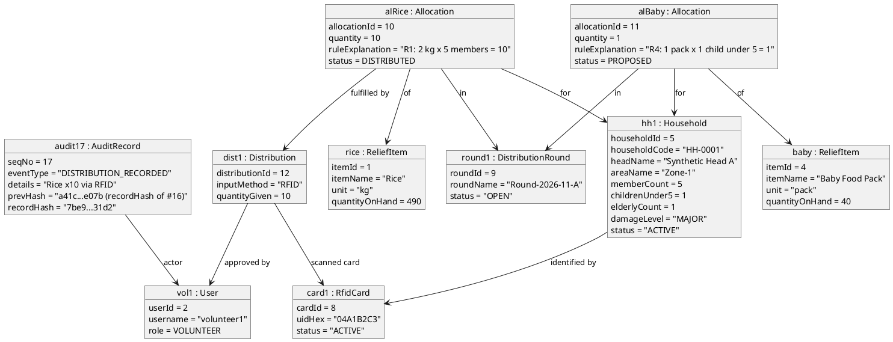

#### Mermaid approximation (renders on GitHub)

Mermaid has no object-diagram type, so each instance is drawn as a class box labelled `name : Class`. Read the boxes as **objects**, not classes.

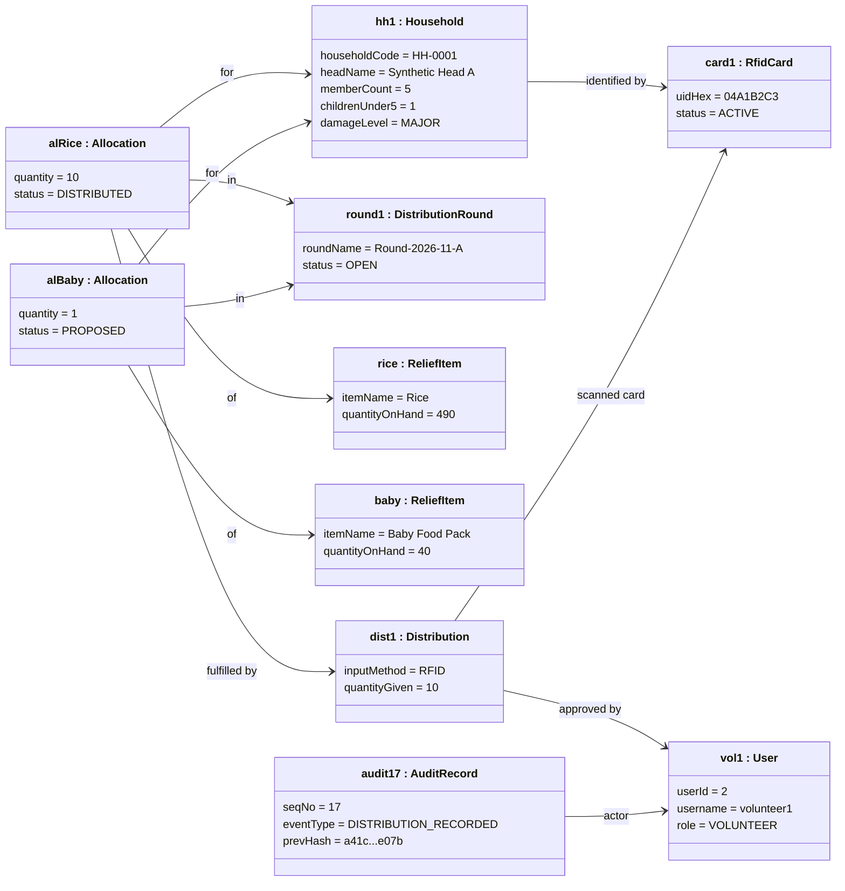

---

### 10.7 Consistency check across diagrams

| Concept | DFD | Use Case | Activity | ERD | Class | Object |
|---|---|---|---|---|---|---|
| Household | D1, P1, P3 | UC1, UC2 | lookup step | `HOUSEHOLD` | `Household` | `hh1` |
| RFID card | D1, P1, P3 | UC3, UC4, UC5 | scan step | `RFID_CARD` | `RfidCard` | `card1` |
| Relief item / stock | D2, P2 | UC6 | stock check | `RELIEF_ITEM`, `INVENTORY_TRANSACTION` | `ReliefItem`, `InventoryService` | `rice`, `baby` |
| Distribution round | D3, P2 | UC7 | round check | `DISTRIBUTION_ROUND` | `DistributionRound` | `round1` |
| Allocation proposal | D3, P4 | UC8 | proposal step | `ALLOCATION` | `Allocation`, `AllocationService` | `alRice`, `alBaby` |
| Distribution | D4, P5 | UC9 | transaction partition | `DISTRIBUTION` | `Distribution`, `DistributionService` | `dist1` |
| Audit | D5, P6 | UC11 | audit steps | `AUDIT_RECORD` | `AuditRecord`, `AuditService` | `audit17` |
| Roles | external entities | actors | "role checked" | `APP_USER.role` | `User`, `Role` | `vol1` |

---

## 11. GUI Design and Five-Class Mapping

### 11.1 Screen-by-screen description

| Screen | Purpose | Main controls | Calls |
|---|---|---|---|
| **Dashboard** (`DashboardFrame`) | Overview and navigation | Role label, counts (households, distributions, audit records), low-stock count, reader status, tabs | all panels |
| **Household Registration / Search** (`HouseholdPanel`) | Register households, search, assign card | Search box, results table, registration form, card UID box | `HouseholdService` |
| **Relief Stock** (`StockPanel`) | View stock, receive stock (Coordinator) | Item table with LOW flag, quantity spinner, "Receive stock" button | `InventoryService` |
| **Allocation and Distribution** (`DistributionPanel`) | Identify, review, approve or reject | Card UID box with "Simulate card scan", manual search, proposal table with explanation, Generate / Approve / Reject buttons | `HouseholdService`, `AllocationService`, `DistributionService` |
| **Audit and Reports** (`AuditPanel`) | Verify chain, view log, summary | Audit table, "Verify audit chain", result label, "Summary report" | `AuditService` |

Controls that a role may not use are **disabled** (for example, "Receive stock" for a Volunteer), but the real check is in the **service layer**, so the GUI is not the only defence.

### 11.2 Wireframes

**Dashboard**

```text
+--------------------------------------------------------------------+
| ReliefTrace - volunteer1 (VOLUNTEER)                               |
+--------------------------------------------------------------------+
| [Dashboard] [Households] [Stock] [Distribution] [Audit & Reports]  |
+--------------------------------------------------------------------+
|  Signed in as: volunteer1 (VOLUNTEER)                              |
|                                                                    |
|  Households registered ........ 3                                  |
|  Distributions recorded ....... 1                                  |
|  Low-stock items .............. 0                                  |
|  RFID reader .................. not connected (use manual search)  |
|  Audit records ................ 17                                 |
+--------------------------------------------------------------------+
```

**Household Registration / Search**

```text
+--------------------------------------------------------------------+
| Search (code / name / area): [____________] [Search]               |
+--------------------------------------------------------------------+
| Code     | Head              | Area   | Members | <5 | Elderly | Dmg |
| HH-0001  | Synthetic Head A  | Zone-1 | 5       | 1  | 1       | MAJ |
| HH-0002  | Synthetic Head B  | Zone-1 | 3       | 0  | 0       | MIN |
+--------------------------------------------------------------------+
| Register: Head [______] Area [____] Members [4] <5 [0] Elderly [0] |
|           [MAJOR v] [Register]                                     |
| Card UID: [________] [Assign card to selected]                     |
+--------------------------------------------------------------------+
```

**Relief Stock**

```text
+--------------------------------------------------------------------+
| ID | Item            | Unit   | On hand | Low level | Status        |
| 1  | Rice            | kg     | 490     | 50        | OK            |
| 2  | Drinking Water  | bottle | 600     | 60        | OK            |
| 3  | Blanket         | pcs    | 120     | 10        | OK            |
| 4  | Baby Food Pack  | pack   | 40      | 5         | OK            |
+--------------------------------------------------------------------+
| Quantity: [10] [Receive stock for selected item]   (Coordinator)   |
+--------------------------------------------------------------------+
```

**Allocation and Distribution**

```text
+--------------------------------------------------------------------+
| Card UID: [04A1B2C3] [Simulate card scan]                          |
| Manual (code/name): [________] [Manual search]                     |
| Household: HH-0001 - Synthetic Head A | members 5 | identified by  |
|            RFID 04A1B2C3                                           |
+--------------------------------------------------------------------+
| ID | Item           | Qty | Status      | Explanation               |
| 10 | Rice           | 10  | DISTRIBUTED | R1: 2 kg x 5 members = 10 |
| 11 | Baby Food Pack | 1   | PROPOSED    | R4: 1 pack x 1 child ...  |
+--------------------------------------------------------------------+
| [Generate proposals] [Approve & record] [Reject selected]          |
+--------------------------------------------------------------------+
```

**Audit and Reports**

```text
+--------------------------------------------------------------------+
| Seq | Time (UTC)        | Event                 | Entity   | Hash   |
| 16  | 2026-11-24T09:...  | ALLOCATION_PROPOSED   | Alloc#11 | a41c.. |
| 17  | 2026-11-24T09:...  | DISTRIBUTION_RECORDED | Dist#12  | 7be9.. |
+--------------------------------------------------------------------+
| [Verify audit chain] [DEMO: tamper selected] [Summary report]      |
| VALID: Chain intact: 17 record(s) verified.                        |
| Distributed totals:  Rice (kg): 10                                 |
+--------------------------------------------------------------------+
```

### 11.3 Java project folder structure

```text
relieftrace/
|-- pom.xml                          (when you move to Maven + SQLite)
`-- src/main/java/relieftrace/
    |-- app/        Main.java
    |-- model/      User, Household, RfidCard, ReliefItem, DistributionRound,
    |               Allocation, Distribution, AuditRecord
    |-- db/         DatabaseManager
    |-- service/    HouseholdService, InventoryService, AllocationService,
    |               DistributionService, AuditService, VerificationResult
    |-- hardware/   RfidSerialService, CardScanListener
    `-- ui/         DashboardFrame, HouseholdPanel, StockPanel,
                    DistributionPanel, AuditPanel
```

### 11.4 Responsibilities of important classes

| Class | Responsibility |
|---|---|
| `DashboardFrame` | Main window; builds tabs; shows summary; connects the reader listener; refreshes panels. |
| `HouseholdPanel` | Collects registration input, displays search results, triggers card assignment. Contains no SQL. |
| `StockPanel` | Shows items and low-stock flags; triggers stock receipt. |
| `DistributionPanel` | Implements `CardScanListener`; identifies household (scan or manual); shows proposals; triggers approve or reject. |
| `AuditPanel` | Shows the log; runs verification; shows summary report. |
| `HouseholdService` | Validates and registers households; searches; maps UID to household; assigns/revokes cards; checks roles. |
| `InventoryService` | Lists items; receives or adjusts stock with a ledger entry; checks roles. |
| `AllocationService` | Applies rules R1 to R5; refuses duplicate proposals; stores explanations. |
| `DistributionService` | Performs the single approval transaction; rejects with reason; blocks duplicates. |
| `AuditService` | Appends hash-chained records; verifies the chain. |
| `RfidSerialService` | Opens the COM port, parses `UID:` lines, notifies the listener; reports connection state. |
| `DatabaseManager` | Opens SQLite, creates the schema, manages transactions, creates backups. |
| Entity classes | Hold data and simple rules (for example, `ReliefItem.decrease` refuses to go below zero). |

### 11.5 Mapping table: GUI classes to Class Diagram elements

The assignment requires **at least five classes used in the interface that are also in the Class Diagram**. Five UI classes and five model classes below satisfy this.

| GUI class (Java) | In Class Diagram (10.E) | Works with | Model classes it displays |
|---|---|---|---|
| `DashboardFrame` | Yes, `<<ui>>`, composes the four panels | `RfidSerialService` | counts from all models |
| `HouseholdPanel` | Yes, `<<ui>>` | `HouseholdService` | `Household`, `RfidCard` |
| `StockPanel` | Yes, `<<ui>>` | `InventoryService` | `ReliefItem` |
| `DistributionPanel` | Yes, `<<ui>>`, implements `CardScanListener` | `HouseholdService`, `AllocationService`, `DistributionService` | `Household`, `Allocation`, `Distribution` |
| `AuditPanel` | Yes, `<<ui>>` | `AuditService` | `AuditRecord`, `VerificationResult` |

**How they work together.** `DashboardFrame` builds the services' panels and registers `DistributionPanel` as the listener of `RfidSerialService`. A card scan (or the "Simulate card scan" button) calls `onCardScanned`, which asks `HouseholdService.findByCardUid`. The panel then calls `AllocationService.generateProposals`, and on approval `DistributionService.approveAndRecord`, which writes an audit record through `AuditService`. `AuditPanel` reads those records back for verification.

### 11.6 Optional implementation sample (separate from the design)

The repository contains a **small compilable Swing prototype** under `src/main/java/relieftrace/` with 23 Java files that follow the class diagram. It is **not** the final system.

| Aspect | Prototype | Final design |
|---|---|---|
| Storage | **In-memory** `DatabaseManager` stand-in (no libraries needed) | SQLite via JDBC and `schema.sql` |
| Transaction | Checks first, then mutates inside one `synchronized` block | SQL transaction with guarded `UPDATE` (see 12.4) |
| Serial | `RfidSerialService` parses lines but **does not open a COM port**; `connect` always reports "not connected"; "Simulate card scan" injects a UID | `jSerialComm` or equivalent |
| Login | Role chosen from a dialog at start | Login with salted password hash |
| Design items not in prototype | `revokeCard`, `adjustStock`, round management screen, CSV export, backup, `DatabaseManager.getConnection` and transaction methods | To be built in Weeks 1 to 8 |

Compile and run (JDK 17+):

```bash
javac -d out $(find src -name "*.java")      # on Windows use: dir /s /b src\*.java > files.txt ; javac -d out @files.txt
java -cp out relieftrace.app.Main
```

### 11.7 What has and has not been verified

| Item | Status |
|---|---|
| `database/schema.sql` + `seed_synthetic.sql` | Loaded into SQLite (Python `sqlite3`); constraint probes for duplicate allocation, second active card, bad UID, negative stock, distribution on non-PROPOSED allocation, audit update/delete all **blocked as intended**. |
| Java prototype | **Compiled** with JDK 21 (`javac`, only lint warnings). A **headless smoke test of the service layer** passed 15 of 15 checks (card lookup, proposals, duplicate block, stock reduction, role checks, hash chain valid, tamper detected, UID line parsing, boundary validation). |
| Swing windows | **Not launched or visually inspected** in the environment used to prepare this document. Run it yourself and take screenshots. |
| ESP32 sketch, wiring, serial link, real cards | **Not tested.** No hardware was available. |
| Mermaid and PlantUML | All **9 Mermaid blocks passed Mermaid's own syntax parser** (Mermaid 11.x via Node). They were **not visually rendered**, so check layout on GitHub. The **3 PlantUML blocks were not checked** with any tool; preview them before submitting (Appendix D). |
| System-level test plan (Section 13) | **Not executed.** No results are claimed. |

---

## 12. Database and Hardware Design

### 12.1 SQLite schema and important constraints

The full DDL is in [Appendix A](#appendix-a-full-sqlite-schema) and in `database/schema.sql`.

| Constraint | Purpose |
|---|---|
| `PRAGMA foreign_keys = ON` | SQLite does **not** enforce foreign keys unless enabled on every connection. |
| `household_code UNIQUE` | Prevents duplicate household codes. |
| `rfid_card.uid_hex UNIQUE` + `CHECK` on length and hex | One UID maps to one card; malformed UIDs rejected. |
| Partial unique index `ux_one_active_card` | At most one ACTIVE card per household. |
| `relief_item.quantity_on_hand CHECK (>= 0)` | Stock can never be negative. |
| `allocation UNIQUE(round_id, household_id, item_id)` | One allocation per household, item, round. |
| `distribution.allocation_id UNIQUE` | One handover per allocation. |
| `inventory_transaction CHECK` | DISTRIBUTE rows must link a distribution. |
| `audit_record` triggers | Block UPDATE and DELETE (defence in depth only; someone with file access can drop triggers, which is why the hash chain exists). |
| `trg_distribution_requires_proposed` | Database refuses a distribution for an allocation that is not PROPOSED. |

**Soft duplicate households.** Two real households may share a name. The system therefore **warns** on a matching (head name, area, phone) but does not forbid it. It is an assumption that the coordinator resolves such warnings.

### 12.2 Household-to-card mapping

1. Coordinator or Volunteer selects a household and presents a card.
2. UID is received (scan, or typed during bench testing) and normalised to uppercase hex.
3. `assignCard` checks: format valid; UID not already registered; household has no ACTIVE card.
4. A row is inserted in `rfid_card` and an audit record `CARD_ASSIGNED` is appended.
5. Lost card: Coordinator sets status `LOST` or `REVOKED`, then a new card can be assigned. A revoked UID stays in the table, so the same physical card cannot silently be reassigned to another household.

### 12.3 ESP32, RC522, and USB Serial

**How the ESP32 reads the RC522 UID.** The RC522 is a 13.56 MHz reader chip that talks to the ESP32 over SPI. The sketch ([Appendix B](#appendix-b-esp32-sketch)) uses the `MFRC522` library: `PICC_IsNewCardPresent()` detects a card, `PICC_ReadCardSerial()` reads its UID (4, 7, or 10 bytes), and the sketch formats it as uppercase hex.

**How USB Serial passes the UID to Java.** The ESP32 prints one ASCII line per scan at 115200 baud:

```text
READY
UID:04A1B2C3
```

The Java `RfidSerialService` reads lines, accepts only lines matching `UID:` followed by 8, 14, or 20 hex characters, ignores everything else, and calls `CardScanListener.onCardScanned(uid)`. The sketch debounces (same card ignored for 2 s) so one tap gives one event.

Design sample for the Java side (jSerialComm; **untested design sample**):

```java
SerialPort port = SerialPort.getCommPort("COM3");          // chosen by the user or auto-detected
port.setComPortParameters(115200, 8, SerialPort.ONE_STOP_BIT, SerialPort.NO_PARITY);
port.setComPortTimeouts(SerialPort.TIMEOUT_READ_BLOCKING, 0, 0);
if (!port.openPort()) { connected = false; return false; }   // fall back to manual search
Thread reader = new Thread(() -> {
    try (BufferedReader in = new BufferedReader(new InputStreamReader(port.getInputStream()))) {
        String line;
        while ((line = in.readLine()) != null) handleLine(line);
    } catch (IOException e) { connected = false; }
});
reader.setDaemon(true);
reader.start();
```

**Card compatibility (do not assume).** The RC522 is designed for ISO/IEC 14443A cards at 13.56 MHz (commonly MIFARE Classic, Ultralight, NTAG types). **125 kHz cards will not work.** Before design lock-in, test every card type you plan to use and record the result:

| Card type tested | Read OK? | UID length | Notes |
|---|---|---|---|
| `[fill in]` | `[yes/no]` | `[4/7/10 bytes]` | `[date]` |

**Fallback to manual search.** If `connect` fails, the port disappears, or the UID is unknown/revoked, `DistributionPanel` shows a message and the volunteer uses **Manual search**. The distribution is then recorded with `input_method = MANUAL`, which appears in reports so that frequent manual use is visible.

### 12.4 Inventory reduction in one transaction

On approval, `DistributionService.approveAndRecord` performs all steps or none:

```java
Connection c = db.getConnection();
c.setAutoCommit(false);
try {
    // 1. Re-read the allocation; it must still be PROPOSED, and the round must be OPEN
    // 2. Guarded stock update: succeeds only if enough stock remains
    try (PreparedStatement ps = c.prepareStatement(
            "UPDATE relief_item SET quantity_on_hand = quantity_on_hand - ? " +
            "WHERE item_id = ? AND quantity_on_hand >= ?")) {
        ps.setInt(1, qty); ps.setInt(2, itemId); ps.setInt(3, qty);
        if (ps.executeUpdate() != 1) throw new IllegalStateException("Insufficient stock");
    }
    // 3. INSERT INTO distribution (...)        -- trigger checks allocation is PROPOSED
    // 4. INSERT INTO inventory_transaction (... 'DISTRIBUTE', -qty, distribution_id ...)
    // 5. UPDATE allocation SET status = 'DISTRIBUTED'
    // 6. Read last audit_record, compute hash, INSERT new audit_record
    c.commit();
} catch (Exception ex) {
    c.rollback();     // nothing is half-done
    throw ex;         // simplified: declare "throws Exception" or wrap it
}
```

The audit record is written **inside the same transaction**, so a committed distribution always has its audit record, and a rolled-back one leaves none.

### 12.5 Preventing duplicate distributions within a round

Three layers, from weakest to strongest:

1. **UI/service**: proposals are not regenerated for items already allocated; the Distribution screen shows status.
2. **Service**: `approveAndRecord` refuses any allocation that is not PROPOSED and logs `DUPLICATE_BLOCKED`.
3. **Database**: `UNIQUE(round_id, household_id, item_id)` and `UNIQUE(allocation_id)` make a second row impossible even if Java code has a bug.

### 12.6 Hash-chain verification

**Record hash.** For each audit record:

```text
record_hash = SHA-256( f(seq_no) + f(event_time) + f(event_type) + f(entity_type)
                       + f(entity_id) + f(actor_user_id) + f(details) + f(prev_hash) )
where f(x) = length(x) + ":" + x + ";"        (length-prefixed, so field boundaries are unambiguous)
```

The first record uses `prev_hash` = 64 zeros. `verifyChain()` walks records in order and checks, for each: sequence number is exactly one more than the previous; `prev_hash` equals the previous record's `record_hash`; recomputed hash equals stored `record_hash`. It returns the **first broken sequence number**.

| Tampering scenario | Detected? | Why |
|---|---|---|
| Edit a field of record #k | **Yes**, at #k | Recomputed hash differs. |
| Delete a record in the middle | **Yes** | Sequence gap and broken link. |
| Swap two records | **Yes** | Sequence or link mismatch. |
| Edit record #k and recompute only its hash | **Yes**, at #k+1 | #k+1's `prev_hash` no longer matches. |
| Delete the **last** records | **No**, from the chain alone | Remaining chain is internally consistent. Mitigation: print or export the latest `seq_no` and hash at the end of each day and keep it elsewhere. |
| Rewrite **all** records and recompute every hash | **No**, from the chain alone | No secret is involved. Mitigation: the same external anchor; optional future work is an HMAC with a key kept outside the database. |
| Data that was false when first entered | **No** | The chain proves *change*, not *truth*. |

Details in `details` should avoid unnecessary personal data (use IDs and codes rather than names).

### 12.7 Local backups and access control

**Backups**
- Coordinator-only "Back up database" copies the SQLite file using SQLite's online-safe method `VACUUM INTO 'path'` or a file copy while the app is closed (verify the exact approach during implementation).
- Name backups with date and time; keep at least two copies on **different** media (for example, a USB drive and a second PC).
- After each backup, record the latest audit `seq_no` and `record_hash` on the closure sheet.
- Test a restore at least once before the demo.
- Backups contain personal data in real use, so they need the same protection as the database. **Never commit them to GitHub.**

**Access control**
- Role checks live in the **service layer**; the UI also disables controls for clarity.
- Passwords are stored as salted PBKDF2 hashes (available in the standard Java library). No default password in source code; the first-run screen creates the first Coordinator.
- Protect the machine with a Windows account password and restrict the database folder to the operating-system users who need it. Disk encryption (for example BitLocker where available) is recommended. SQLite itself is **not encrypted** by default.
- Auto-lock or logout after inactivity is a proposed improvement.

---

## 13. Testing and Quality Assurance

> **No results are claimed in this document.** Columns "Result" and "Evidence" are to be filled in during Week 7 with real outcomes. All data is **synthetic** (names like "Synthetic Head A"). No real disaster victims' data may be used.

### 13.1 Test data

3 to 20 synthetic households with varied sizes; one performance set of 5,000 generated households; 4 items; 2 cards; 1 open round. The repository seed file `database/seed_synthetic.sql` is an example.

### 13.2 Test cases

| ID | Category | Scenario and input | Expected result | Result / Evidence |
|---|---|---|---|---|
| T-F-01 | Functional | Register valid household (5 members, 1 child, 1 elderly) | Saved; code HH-nnnn shown; audit record added | |
| T-F-02 | Functional | Search by code, partial name, area | Matching rows listed | |
| T-F-03 | Functional | Assign card UID `04A1B2C3` to HH-0001 | Mapping saved; audit CARD_ASSIGNED | |
| T-F-04 | Functional | Receive 100 rice as Coordinator | Stock +100; ledger row RECEIVE | |
| T-F-05 | Functional | Generate proposals for 5-member, 1 child household | Rice 10, Water 15, Blanket 3, Baby Food 1, each with explanation | |
| T-F-06 | Functional | Approve rice proposal | Distribution saved; stock -10; status DISTRIBUTED; audit record | |
| T-F-07 | Functional | Reject proposal with reason | Status REJECTED; reason stored; stock unchanged | |
| T-V-01 | Validation | Members = 0 | Rejected with message | |
| T-V-02 | Boundary | Members = 1 and = 30 | Accepted | |
| T-V-03 | Boundary | Members = 31 | Rejected | |
| T-V-04 | Validation | Children 3 + elderly 3 with 5 members | Rejected | |
| T-V-05 | Validation | Blank head name | Rejected | |
| T-V-06 | Validation | UID `ZZ12` or 6 hex characters | Rejected | |
| T-V-07 | Boundary | Receive stock quantity 0 and -5 | Rejected | |
| T-D-01 | Duplicate | Approve the same allocation twice | Second attempt blocked; DUPLICATE_BLOCKED audit; stock reduced once | |
| T-D-02 | Duplicate | Generate proposals twice in same round | No second set of allocations | |
| T-D-03 | Duplicate | Insert duplicate allocation directly via SQL | Database rejects (UNIQUE) | |
| T-D-04 | Duplicate | Same household in a **new** round | New proposals allowed | |
| T-D-05 | Duplicate | Assign a second ACTIVE card to one household | Rejected | |
| T-D-06 | Duplicate | Register same UID to two households | Rejected | |
| T-S-01 | Stock | Item stock 5, proposal rule says 10 | Proposal limited to 5 and explanation says so | |
| T-S-02 | Stock | Approve when stock changed to less than quantity after proposal | Blocked; no negative stock | |
| T-S-03 | Stock | 100 sequential approvals across households | Final stock = start minus sum of distributions; ledger sums match | |
| T-S-04 | Stock | Force failure mid-transaction (for example, simulated exception before commit) | Rollback; stock, distribution, audit all unchanged | |
| T-S-05 | Stock | `UPDATE` stock below zero via SQL | Database rejects (CHECK) | |
| T-R-01 | RFID unavailable | Start with reader unplugged | App starts; status "not connected"; manual search works | |
| T-R-02 | RFID unavailable | Unplug reader during use | Message shown; manual mode continues; no crash | |
| T-R-03 | RFID | Unknown UID scanned | "Unknown card" message; manual search offered | |
| T-R-04 | RFID | Revoked card scanned | Treated as not found | |
| T-R-05 | RFID | Garbage line over serial | Ignored | |
| T-R-06 | RFID | Same card held for 3 s | One event only (debounce) | |
| T-R-07 | RFID | Distribution via manual lookup | Stored with input method MANUAL | |
| T-OFF-01 | Offline | Disable all network adapters, run full flow | All functions work | |
| T-A-01 | Audit | Verify untouched chain | VALID with record count | |
| T-A-02 | Audit | Edit `details` of record #k (drop trigger first, then SQL `UPDATE`) | BROKEN at #k | |
| T-A-03 | Audit | Delete middle record | BROKEN at gap | |
| T-A-04 | Audit | Swap two records | BROKEN | |
| T-A-05 | Audit | Edit record and recompute its own hash | BROKEN at next record | |
| T-A-06 | Audit | Delete last record | **Not detected** by chain; detected by comparing the daily closure hash. Record this as a known limitation. | |
| T-X-01 | Role | Auditor tries to approve | Refused | |
| T-X-02 | Role | Volunteer tries to receive stock | Refused | |
| T-X-03 | Role | Auditor opens audit log and verifies | Allowed | |
| T-B-01 | Backup | Back up, restore to new file, verify chain | Data identical; chain VALID | |
| T-P-01 | Performance | Lookup in 5,000 synthetic households | Result in target time (NFR-03) | |

### 13.3 Acceptance criteria and measurable outcomes

| ID | Criterion | Measure |
|---|---|---|
| AC1 | All **Must** requirements implemented | 100% of FR marked Must are demonstrable |
| AC2 | Test execution | 100% of cases in 13.2 executed with result recorded; every failure has a logged defect |
| AC3 | Duplicate protection | 0 duplicate distributions in T-D tests |
| AC4 | Stock consistency | 0 negative stock values; ledger sum equals stock change in T-S-03 |
| AC5 | Audit verification | Detects all five detectable scenarios in T-A-02 to T-A-05 and the clean-chain pass; limitation in T-A-06 documented |
| AC6 | Manual fallback | End-to-end distribution completed with reader disconnected |
| AC7 | Offline | Full flow completed with network disabled |
| AC8 | Responsiveness | Lookup within NFR-03 target, or measured value and explanation reported |
| AC9 | Submission | Repository contains items in Section 15.5 and no prohibited files |

### 13.4 Quality practices

Short code reviews against the class diagram before each milestone; meaningful commit messages; one issue per defect; keep services free of Swing code and panels free of SQL.

---

## 14. Risk, Security, Privacy, and Limitations

### 14.1 Risk register

| ID | Risk | Likelihood | Impact | Mitigation |
|---|---|---|---|---|
| R1 | RC522 does not read the available cards | Medium | Medium | Week 1 to 2 bench spike; buy compatible 13.56 MHz ISO 14443A cards; manual mode is a full feature |
| R2 | ESP32 wiring or driver problems on Windows (USB-serial driver) | Medium | Medium | Time-box spike; document driver steps; use simulated scans for software testing |
| R3 | Too little time (1 to 2 hours per day) | Medium | High | MVP-first order; hardware after MVP; weekly checkpoint; drop optional items first (CSV export, revoke UI) |
| R4 | SQLite or JDBC setup errors | Low | Medium | Set up in Week 1; commit working skeleton early |
| R5 | Data loss (disk failure, file corruption) | Low | High | Regular backups to two media; restore test |
| R6 | Unauthorised access to the computer or database | Medium | High | Windows account lock, folder permissions, disk encryption where possible, role checks |
| R7 | Cloned or lost card used by another person | Medium | Medium | Human approval at handover; visual household check; revoke lost cards; manual review of repeated manual lookups |
| R8 | Audit chain mistaken for proof of truth or fairness | Medium | Medium | State limits clearly in README and report (Section 3.3, 12.6) |
| R9 | Scope creep | High | Medium | Out-of-scope list (5.3); backlog file |
| R10 | Real personal data accidentally committed | Low | High | `.gitignore`, synthetic data only, pre-commit check of file list (Section 15.6) |

### 14.2 Security considerations

- Separate roles with least privilege; checks in the service layer.
- Salted password hashes; no secrets in source control.
- Parameterised SQL (`PreparedStatement`) everywhere to prevent SQL injection.
- Audit trail for state changes; chain verification by Auditor.
- Serial input is untrusted: validate format and length before use.
- SQLite file is unencrypted by default; use OS-level protection.

### 14.3 Privacy

- Collect only data needed for distribution (no national ID numbers, no photographs in the base design).
- **Synthetic data only** during this assignment.
- In real use, the operating organisation would need consent practices, retention rules, and compliance with applicable law, which this student project does not provide.
- Keep personal details out of audit `details`; use codes and IDs.

### 14.4 Limitations

1. UID-only identification is **not secure authentication**; the system depends on human approval.
2. The hash chain detects modification but cannot prove original truth or fair allocation, and cannot detect deletion of the final records or a full recomputed rewrite without an external anchor.
3. Single computer, no synchronisation or concurrent multi-user access.
4. SQLite database is not encrypted by default.
5. Allocation rules are illustrative and not policy advice.
6. Compatibility with specific card types is unproven until tested.
7. Performance and usability targets are targets, not measured results.
8. No claim of uniqueness, guaranteed fairness, or complete fraud prevention is made.

---

## 15. GitHub Repository and Submission Plan

> No repository has been created and no URL is claimed. Replace the placeholder below after you create it.

### 15.1 Repository name

Suggested: **`relieftrace-offline-rfid-relief-distribution`**
URL form (placeholder): `https://github.com/<your-username>/relieftrace-offline-rfid-relief-distribution`
Visibility: **private** until the teacher asks for access or the deadline, then follow the instructions given by your teacher. Do not publish real data under any visibility.

### 15.2 Recommended folder structure

```text
relieftrace-offline-rfid-relief-distribution/
|-- README.md
|-- .gitignore
|-- docs/
|   |-- ReliefTrace_Assignment.md        (this document)
|   |-- ReliefTrace_Assignment.pdf       (exported copy for submission)
|   |-- diagrams/                        (PNG/SVG exports of the six diagrams)
|   `-- screenshots/                     (GUI and hardware photos)
|-- database/
|   |-- schema.sql
|   `-- seed_synthetic.sql
|-- hardware/
|   `-- esp32_rc522_reader/esp32_rc522_reader.ino
|-- src/main/java/relieftrace/{app,model,db,service,hardware,ui}/
|-- src/test/java/                       (tests, when added)
`-- pom.xml                              (when you adopt Maven)
```

### 15.3 Suggested README sections

1. Project title and one-paragraph summary
2. Status badge or table (what works, what is planned)
3. Features
4. Architecture overview (one diagram)
5. Hardware (parts list, wiring, serial protocol)
6. Requirements and setup (Java version, libraries, drivers)
7. How to build and run
8. How to run the demo with synthetic data (including "Simulate card scan")
9. Screenshots
10. Testing summary (link to results table)
11. Security, privacy, and limitations (include the honesty notes)
12. Repository layout
13. Author, course, university; licence note

### 15.4 Commit plan across milestones

| Milestone | Example commits (small, frequent) | Tag |
|---|---|---|
| M0 | `docs: add proposal and requirements` · `db: add schema and synthetic seed` · `chore: add gitignore and README stub` · `hardware: add RC522 read sketch and spike notes` | `v0.0-baseline` |
| M1 | `ui: add DashboardFrame shell` · `feat: household registration and search` · `feat: stock management and rounds` | `v0.1-data-screens` |
| M2 | `feat: allocation rules R1-R5 with explanations` · `feat: transactional approve-and-record` · `feat: duplicate distribution protection` · `test: duplicate and stock tests` | `v0.2-mvp` |
| M3 | `feat: SHA-256 audit chain` · `feat: verify chain` · `feat: reports and backup` | `v0.3-auditable` |
| M4 | `feat: RfidSerialService and UID parsing` · `feat: scan to household on Distribution screen` · `docs: card compatibility results` | `v0.4-rfid` |
| M5 | `test: record test results` · `fix: defects from testing` | `v0.5-tested` |
| M6 | `docs: final diagrams and screenshots` · `docs: finalise README and report` | `v1.0-submission` |

Use short imperative messages, one purpose per commit, and push at least at the end of each study session.

### 15.5 Files and screenshots to include

- This report (Markdown and PDF), the six diagrams as exported images, `schema.sql`, `seed_synthetic.sql`, ESP32 sketch, all source code, README.
- Screenshots: all five screens; a proposal with explanation; a blocked duplicate; a low-stock flag; audit "VALID" and "BROKEN" results; the serial monitor showing `UID:`; a photo of the wired hardware (no personal data visible).
- Test results table with dates and evidence.
- Optional: short demo video hosted elsewhere and linked.

### 15.6 What must **not** be committed

| Do not commit | Why |
|---|---|
| Real or realistic personal data of any affected person, real UIDs of cards tied to real people | Privacy |
| `*.db`, `*.sqlite`, backups, SQLite journal/WAL files | May contain personal data; binary |
| Passwords, API keys, `.env`, certificates, `credentials*.json`, serial-port configs with secrets | Secrets |
| Build output (`target/`, `out/`, `*.class`, `*.jar`) | Unnecessary binaries; rebuilt from source |
| IDE folders (`.idea/`, `.vscode/`, `*.iml`) | Machine-specific |
| Large videos or datasets | Repository bloat; host elsewhere |

**Pre-push check:** run `git status` and `git diff --cached --name-only` and read the list.

### 15.7 Submission checklist

- [ ] Repository created and URL pasted into the title page
- [ ] README complete; run instructions verified on a clean checkout
- [ ] Six diagrams render (GitHub preview checked) and exported images saved
- [ ] Test results filled in honestly
- [ ] No prohibited files committed
- [ ] PDF export of the report created
- [ ] Teacher added as collaborator or link submitted as instructed

---

## 16. Conclusion

ReliefTrace addresses a concrete problem: recording relief distribution accurately and accountably when internet and smartphones are unavailable. The design combines a simple offline desktop application, explainable rule-based proposals, human approval, database-enforced duplicate and stock protection, an optional RFID reader with a guaranteed manual fallback, and a hash-chained audit trail. An iterative, incremental plan places the manual workflow first and the hardware second, so one student working 1 to 2 hours per day can reach a demonstrable, tested system in eight weeks even if the hardware causes delay.

The design is honest about its limits: RFID UIDs are identifiers and not authentication, a hash chain detects change and not falseness, and a recommendation is not a fairness guarantee. The next step is to begin Increment 0: confirm card compatibility, lock the schema, and create the repository.

---

## 17. References

*Only well-established, real sources are listed. Check edition and access details in your library or on the publisher or vendor site before citing.*

1. I. Sommerville, *Software Engineering*, 10th ed., Pearson, 2015. (Process models, iterative and incremental development, requirements.)
2. R. S. Pressman and B. R. Maxim, *Software Engineering: A Practitioner's Approach*, 9th ed., McGraw-Hill, 2020. (Process models, UML-based modelling, testing.)
3. M. Fowler, *UML Distilled: A Brief Guide to the Standard Object Modeling Language*, 3rd ed., Addison-Wesley, 2004. (Use case, activity, class, and object diagrams.)
4. Object Management Group, *Unified Modeling Language (UML) Specification*, version 2.5.1, 2017. Available at omg.org.
5. National Institute of Standards and Technology, *FIPS PUB 180-4: Secure Hash Standard (SHS)*, 2015. Available at nist.gov.
6. NXP Semiconductors, *MFRC522 Standard performance MIFARE and NTAG frontend* datasheet. Available at nxp.com.
7. Espressif Systems, *ESP32 Series Datasheet* and *ESP32 Technical Reference Manual*. Available at espressif.com.
8. SQLite documentation (foreign keys, partial indexes, triggers, `VACUUM INTO`, transactions). Available at sqlite.org.
9. Oracle, *The Java Tutorials: Creating a GUI with Swing*. Available at docs.oracle.com.
10. Mermaid documentation (flowchart, class diagram, entity-relationship diagram, Gantt). Available at mermaid.js.org.
11. PlantUML language reference. Available at plantuml.com.
12. International Organization for Standardization, *ISO/IEC 14443: Cards and security devices for personal identification, Contactless proximity objects* (background on card types used with 13.56 MHz readers).

---

## Appendix A: Full SQLite Schema

(Identical to `database/schema.sql`.)

```sql
-- ReliefTrace SQLite schema (design). Run once on an empty database.
PRAGMA foreign_keys = ON;

CREATE TABLE app_user (
  user_id        INTEGER PRIMARY KEY AUTOINCREMENT,
  username       TEXT NOT NULL UNIQUE,
  password_hash  TEXT NOT NULL,            -- PBKDF2 hash, never plain text
  salt           TEXT NOT NULL,
  role           TEXT NOT NULL CHECK (role IN ('COORDINATOR','VOLUNTEER','AUDITOR')),
  is_active      INTEGER NOT NULL DEFAULT 1 CHECK (is_active IN (0,1))
);

CREATE TABLE household (
  household_id    INTEGER PRIMARY KEY AUTOINCREMENT,
  household_code  TEXT NOT NULL UNIQUE,     -- e.g. HH-0001
  head_name       TEXT NOT NULL CHECK (length(trim(head_name)) > 0),
  area_name       TEXT NOT NULL,
  phone           TEXT,
  member_count    INTEGER NOT NULL CHECK (member_count BETWEEN 1 AND 30),
  children_under5 INTEGER NOT NULL DEFAULT 0 CHECK (children_under5 >= 0),
  elderly_count   INTEGER NOT NULL DEFAULT 0 CHECK (elderly_count >= 0),
  damage_level    TEXT NOT NULL CHECK (damage_level IN ('MINOR','MAJOR','SEVERE')),
  status          TEXT NOT NULL DEFAULT 'ACTIVE' CHECK (status IN ('ACTIVE','INACTIVE')),
  registered_by   INTEGER NOT NULL REFERENCES app_user(user_id),
  registered_at   TEXT NOT NULL DEFAULT (datetime('now')),
  CHECK (children_under5 + elderly_count <= member_count)
);

CREATE TABLE rfid_card (
  card_id      INTEGER PRIMARY KEY AUTOINCREMENT,
  uid_hex      TEXT NOT NULL UNIQUE
               CHECK (length(uid_hex) IN (8,14,20) AND uid_hex NOT GLOB '*[^0-9A-F]*'),
  household_id INTEGER NOT NULL REFERENCES household(household_id),
  status       TEXT NOT NULL DEFAULT 'ACTIVE' CHECK (status IN ('ACTIVE','REVOKED','LOST')),
  issued_by    INTEGER NOT NULL REFERENCES app_user(user_id),
  issued_at    TEXT NOT NULL DEFAULT (datetime('now'))
);
-- At most one ACTIVE card per household
CREATE UNIQUE INDEX ux_one_active_card ON rfid_card(household_id) WHERE status = 'ACTIVE';

CREATE TABLE relief_item (
  item_id             INTEGER PRIMARY KEY AUTOINCREMENT,
  item_name           TEXT NOT NULL UNIQUE,
  unit                TEXT NOT NULL,
  quantity_on_hand    INTEGER NOT NULL DEFAULT 0 CHECK (quantity_on_hand >= 0),  -- never negative
  low_stock_threshold INTEGER NOT NULL DEFAULT 0 CHECK (low_stock_threshold >= 0)
);

CREATE TABLE distribution_round (
  round_id    INTEGER PRIMARY KEY AUTOINCREMENT,
  round_name  TEXT NOT NULL UNIQUE,
  start_date  TEXT NOT NULL,
  end_date    TEXT NOT NULL,
  status      TEXT NOT NULL DEFAULT 'PLANNED' CHECK (status IN ('PLANNED','OPEN','CLOSED')),
  CHECK (end_date >= start_date)
);

CREATE TABLE allocation (
  allocation_id    INTEGER PRIMARY KEY AUTOINCREMENT,
  round_id         INTEGER NOT NULL REFERENCES distribution_round(round_id),
  household_id     INTEGER NOT NULL REFERENCES household(household_id),
  item_id          INTEGER NOT NULL REFERENCES relief_item(item_id),
  quantity         INTEGER NOT NULL CHECK (quantity > 0),
  rule_explanation TEXT NOT NULL,
  status           TEXT NOT NULL DEFAULT 'PROPOSED' CHECK (status IN ('PROPOSED','DISTRIBUTED','REJECTED')),
  decision_note    TEXT,
  created_at       TEXT NOT NULL DEFAULT (datetime('now')),
  UNIQUE (round_id, household_id, item_id)   -- one allocation per household, item and round
);

CREATE TABLE distribution (
  distribution_id INTEGER PRIMARY KEY AUTOINCREMENT,
  allocation_id   INTEGER NOT NULL UNIQUE REFERENCES allocation(allocation_id), -- one handover per allocation
  approved_by     INTEGER NOT NULL REFERENCES app_user(user_id),
  input_method    TEXT NOT NULL CHECK (input_method IN ('RFID','MANUAL')),
  card_id         INTEGER REFERENCES rfid_card(card_id),
  quantity_given  INTEGER NOT NULL CHECK (quantity_given > 0),
  distributed_at  TEXT NOT NULL DEFAULT (datetime('now')),
  remarks         TEXT,
  CHECK (input_method <> 'RFID' OR card_id IS NOT NULL)
);

CREATE TABLE inventory_transaction (
  txn_id          INTEGER PRIMARY KEY AUTOINCREMENT,
  item_id         INTEGER NOT NULL REFERENCES relief_item(item_id),
  txn_type        TEXT NOT NULL CHECK (txn_type IN ('RECEIVE','DISTRIBUTE','ADJUST')),
  quantity_change INTEGER NOT NULL CHECK (quantity_change <> 0),
  distribution_id INTEGER REFERENCES distribution(distribution_id),
  note            TEXT,
  created_by      INTEGER NOT NULL REFERENCES app_user(user_id),
  created_at      TEXT NOT NULL DEFAULT (datetime('now')),
  CHECK ((txn_type = 'DISTRIBUTE') = (distribution_id IS NOT NULL))
);

CREATE TABLE audit_record (
  seq_no        INTEGER PRIMARY KEY,         -- 1,2,3,... assigned inside the transaction
  event_time    TEXT NOT NULL,
  event_type    TEXT NOT NULL,
  entity_type   TEXT NOT NULL,
  entity_id     INTEGER,
  actor_user_id INTEGER REFERENCES app_user(user_id),
  details       TEXT NOT NULL,
  prev_hash     TEXT NOT NULL CHECK (length(prev_hash) = 64),
  record_hash   TEXT NOT NULL UNIQUE CHECK (length(record_hash) = 64)
);

-- Defence in depth (not a security boundary: a person with file access can drop triggers)
CREATE TRIGGER trg_audit_no_update BEFORE UPDATE ON audit_record
BEGIN SELECT RAISE(ABORT, 'audit_record is append-only'); END;
CREATE TRIGGER trg_audit_no_delete BEFORE DELETE ON audit_record
BEGIN SELECT RAISE(ABORT, 'audit_record is append-only'); END;

CREATE TRIGGER trg_distribution_requires_proposed BEFORE INSERT ON distribution
BEGIN
  SELECT CASE WHEN (SELECT status FROM allocation WHERE allocation_id = NEW.allocation_id) <> 'PROPOSED'
         THEN RAISE(ABORT, 'allocation is not in PROPOSED state') END;
END;

CREATE INDEX ix_household_name ON household(head_name);
CREATE INDEX ix_allocation_household ON allocation(household_id, round_id);
```

---

## Appendix B: ESP32 Sketch

(Identical to `hardware/esp32_rc522_reader/esp32_rc522_reader.ino`. **Not yet bench-tested.** Check the library name and version in the Arduino Library Manager.)

```cpp
// ReliefTrace - ESP32 + RC522 UID reader (DESIGN SAMPLE, not yet bench-tested by the author)
// Library: "MFRC522" (Arduino Library Manager). Board: ESP32 Dev Module.
// Wiring (RC522 -> ESP32): SDA/SS -> GPIO5, SCK -> GPIO18, MOSI -> GPIO23, MISO -> GPIO19,
//                          RST -> GPIO22, GND -> GND, 3.3V -> 3V3  (RC522 is a 3.3 V device; never 5 V)
// Serial protocol (115200 baud, newline-terminated ASCII):
//   READY            sent once at start-up
//   UID:<HEX>        sent when a card is read, e.g. UID:04A1B2C3 (uppercase hex, no separators)
#include <SPI.h>
#include <MFRC522.h>

#define SS_PIN  5
#define RST_PIN 22
MFRC522 rfid(SS_PIN, RST_PIN);

String lastUid = "";
unsigned long lastSentMs = 0;
const unsigned long DEBOUNCE_MS = 2000;   // ignore the same card for 2 s

void setup() {
  Serial.begin(115200);
  SPI.begin(18, 19, 23, SS_PIN);          // SCK, MISO, MOSI, SS
  rfid.PCD_Init();
  Serial.println("READY");
}

void loop() {
  if (!rfid.PICC_IsNewCardPresent() || !rfid.PICC_ReadCardSerial()) return;

  String uid = "";
  for (byte i = 0; i < rfid.uid.size; i++) {
    if (rfid.uid.uidByte[i] < 0x10) uid += "0";
    uid += String(rfid.uid.uidByte[i], HEX);
  }
  uid.toUpperCase();

  if (uid != lastUid || millis() - lastSentMs > DEBOUNCE_MS) {
    Serial.print("UID:");
    Serial.println(uid);
    lastUid = uid;
    lastSentMs = millis();
  }
  rfid.PICC_HaltA();
  rfid.PCD_StopCrypto1();
}
```

---

## Appendix C: LaTeX-Ready Structure

LaTeX is **recommended but not mandatory** unless your official instructions require it. Two easy routes: (1) paste the Markdown into [Pandoc](https://pandoc.org) to produce LaTeX or PDF, or (2) use the skeleton below and export each Mermaid diagram as an image (Appendix D).

```latex
\documentclass[12pt,a4paper]{report}
\usepackage[margin=2.5cm]{geometry}
\usepackage{graphicx,booktabs,longtable,hyperref,listings,pdflscape,pgfgantt}
\title{ReliefTrace: An Offline-First, RFID-Enabled Relief Distribution Management System}
\author{[Student name] \\ Student ID: [IT24051] \\ Department of ICT, MBSTU}
\date{[Date]}
\begin{document}
\maketitle
\tableofcontents
\chapter{Introduction}
\chapter{Problem Statement and Motivation}
\chapter{Objectives and Scope}
\chapter{Requirements Specification}
\chapter{Process Model and Methodology}
\chapter{System Architecture}
\chapter{Project Schedule, Milestones, Deliverables, and Gantt Chart}
\chapter{Diagrams}  % \includegraphics[width=\linewidth]{diagrams/erd.png}
\chapter{GUI Design and Five-Class Mapping}
\chapter{Database and Hardware Design}
\chapter{Testing and Quality Assurance}
\chapter{Risk, Security, Privacy, and Limitations}
\chapter{GitHub Repository and Submission Plan}
\chapter{Conclusion}
\begin{thebibliography}{9}
\bibitem{sommerville} I. Sommerville, \emph{Software Engineering}, 10th ed., Pearson, 2015.
\end{thebibliography}
\end{document}
```

---

## Appendix D: How to Render the Diagrams

| Diagram type | Tool | How |
|---|---|---|
| Mermaid blocks (all `mermaid` fences) | **GitHub** | Render automatically in `.md` files on github.com. |
| Mermaid blocks | VS Code | Install a Mermaid preview extension. |
| Mermaid to PNG/SVG for the PDF | Mermaid CLI (`mmdc`) or the Mermaid Live Editor | Paste the code, export an image. |
| PlantUML blocks | PlantUML in VS Code or IntelliJ, or the PlantUML web server | Paste the code between `@startuml` and `@enduml`, export PNG/SVG. GitHub does **not** render PlantUML fences natively. |

Never paste real data into an online rendering service; the diagrams here contain only synthetic examples, but the habit matters.

---

## Final Compliance Checklist

No official assignment sheet was supplied; the ten requirements in your request are mapped below.

| # | Requirement | Where satisfied |
|---|---|---|
| 1 | Develop an individual project idea | Sections 3, 4, 5 (ReliefTrace) |
| 2 | Professional initial project proposal | Sections 3 to 6 (introduction, problem, objectives, scope, requirements) |
| 3 | Select and justify a software process model | Section 7 (Iterative and Incremental, 7.2 to 7.5) |
| 4 | Project completion schedule | Section 9 (eight weeks, effort budget) |
| 5 | Milestones and deliverables | Section 9.2 (M0 to M6) |
| 6 | Gantt chart | Section 9.1 (Mermaid `gantt`) |
| 7a | Data Flow Diagram (context + Level 1) | Section 10.A |
| 7b | Use Case Diagram | Section 10.B (PlantUML + Mermaid approximation) |
| 7c | Activity Diagram | Section 10.C (PlantUML + Mermaid approximation) |
| 7d | ER Diagram | Section 10.D |
| 7e | Class Diagram | Section 10.E |
| 7f | Object Diagram | Section 10.F (PlantUML + Mermaid approximation) |
| 7g | Diagrams consistent with each other | Section 10.7 |
| 8 | Simple GUI with at least five classes, consistent with Class Diagram | Section 11 (five UI classes + five model classes; mapping table 11.5; wireframes 11.2; optional prototype 11.6) |
| 9 | GitHub repository and submission plan | Section 15 (no URL fabricated) |
| 10 | Professional organisation for academic evaluation | Sections 1 to 17 in the requested order, plus appendices |
| - | Database and hardware explanation | Section 12 |
| - | Testing: functional, validation, duplicate, stock, RFID-unavailable, offline, tamper, acceptance | Section 13 |
| - | Security, privacy, limitations, honesty about claims | Sections 3.3, 12.6, 14 |
| - | LaTeX guidance | Appendix C |
| - | Design vs. implementation clearly separated, nothing falsely claimed as done | Status note at top, 11.6, 11.7 |
| - | Synthetic data only | 5.4 (A5), 13, 14.3, seed file |
| - | Genuine references only | Section 17 |
