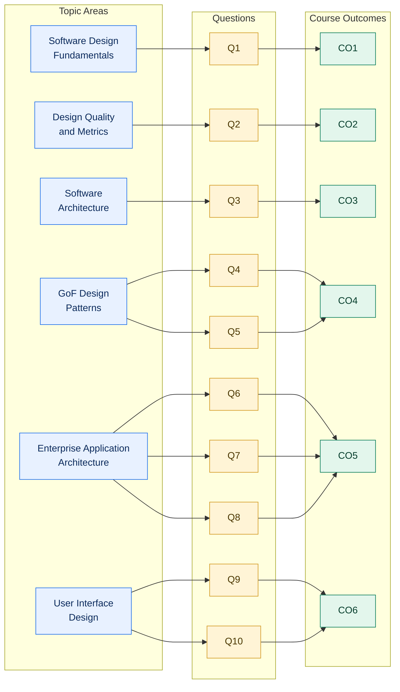
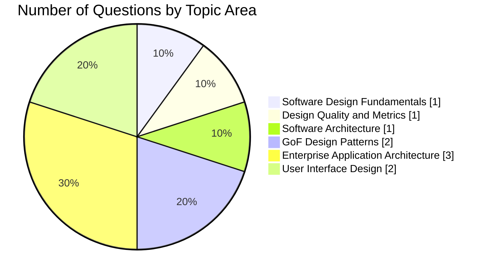
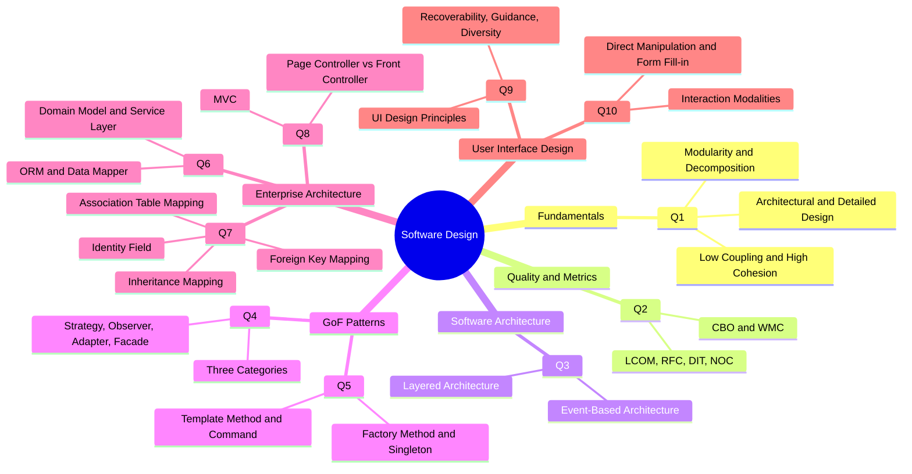
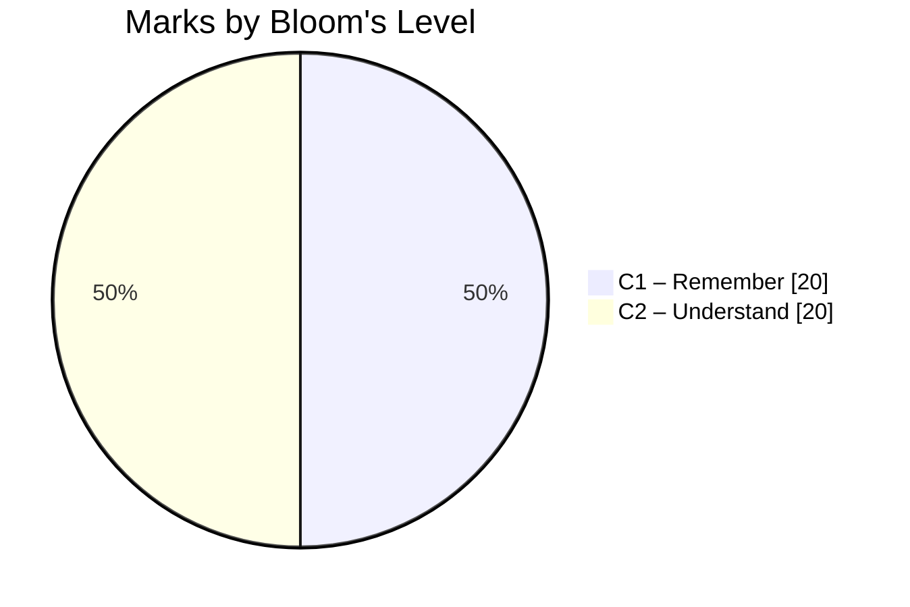
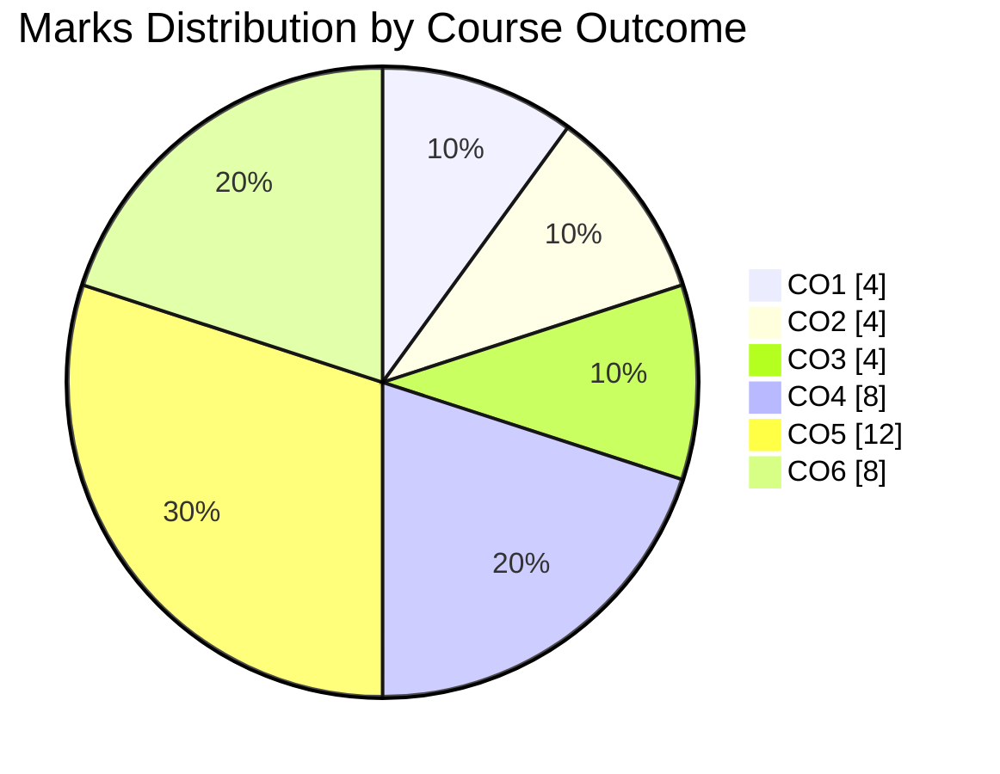

# Software Engineering – Software Design
### OBE-Based Question Paper

**Mawlana Bhashani Science and Technology University**
Department of Information and Communication Technology

---

## Table of Contents

1. [Overview](#1-overview)
2. [Assessment at a Glance](#2-assessment-at-a-glance)
3. [Course Outcomes](#3-course-outcomes-cos)
4. [Topic-to-Question Mapping](#4-topic-to-question-mapping)
5. [Question Paper Structure](#5-question-paper-structure)
6. [Question Paper](#6-question-paper)
7. [Bloom's Taxonomy Alignment](#7-blooms-taxonomy-alignment)
8. [CO Mapping and Mark Distribution](#8-co-mapping-and-mark-distribution)
9. [OBE Alignment](#9-obe-alignment)
10. [Notes](#10-notes)

---

## 1. Overview

This repository contains an Outcome-Based Education (OBE) aligned question paper for the course **Software Engineering – Software Design**.

The paper is prepared from the Software Design lecture materials and follows **Bloom's Taxonomy** to assess learning at the *Remember* (C1) and *Understand* (C2) levels. Every question is mapped to a Course Outcome (CO), a topic area, a cognitive level, and a mark allocation, so that teaching, assessment, and outcomes stay aligned.

## 2. Assessment at a Glance

| Parameter | Details |
|---|---|
| University | Mawlana Bhashani Science and Technology University |
| Department | Information and Communication Technology |
| Course Title | Software Engineering – Software Design |
| Assessment Type | Written Examination |
| Assessment Framework | Outcome-Based Education (OBE) |
| Qualification Framework | Bangladesh National Qualifications Framework (BNQF), Level 7 |
| Learning Domain | Cognitive |
| Bloom's Levels | C1 – Remember, C2 – Understand |
| Number of Questions | 10 (all compulsory) |
| Marks per Question | 4 (2 for part a + 2 for part b) |
| Total Marks | 40 |
| Duration | 1 Hour |

## 3. Course Outcomes (COs)

| CO | Course Outcome |
|---|---|
| **CO1** | Explain the fundamental concepts and principles of software design. |
| **CO2** | Describe software design quality attributes and object-oriented design metrics. |
| **CO3** | Explain software architecture and different architectural styles. |
| **CO4** | Describe the concepts, classifications, and purposes of GoF design patterns. |
| **CO5** | Explain Enterprise Application Architecture, ORM, and presentation logic patterns. |
| **CO6** | Explain fundamental UI design principles and interaction modalities. |

> **Note:** These are proposed COs derived from the lecture materials. Replace them with the officially approved course outcomes if available.

## 4. Topic-to-Question Mapping

The diagram below shows which topic area each question comes from, and which CO it assesses.

### Questions per Topic Area

| Topic Area | Questions | Count | Marks | Distribution |
|---|---|:---:|:---:|---|
| Software Design Fundamentals | Q1 | 1 | 4 | `████` |
| Design Quality and Metrics | Q2 | 1 | 4 | `████` |
| Software Architecture | Q3 | 1 | 4 | `████` |
| GoF Design Patterns | Q4, Q5 | 2 | 8 | `████████` |
| Enterprise Application Architecture | Q6, Q7, Q8 | 3 | 12 | `████████████` |
| User Interface Design | Q9, Q10 | 2 | 8 | `████████` |
| **Total** | **Q1 – Q10** | **10** | **40** | |

### Detailed Topic Coverage

## 5. Question Paper Structure

| Question | Topic Area | Marks | CO | Bloom's Level |
|:---:|---|:---:|:---:|:---:|
| Q1 | Software Design Fundamentals | 4 | CO1 | C1, C2 |
| Q2 | Software Design Quality and Metrics | 4 | CO2 | C1, C2 |
| Q3 | Software Architecture and Architectural Styles | 4 | CO3 | C1, C2 |
| Q4 | GoF Design Patterns | 4 | CO4 | C1, C2 |
| Q5 | Creational and Behavioral Design Patterns | 4 | CO4 | C1, C2 |
| Q6 | Enterprise Application Architecture | 4 | CO5 | C1, C2 |
| Q7 | Object-Relational Mapping Patterns | 4 | CO5 | C1, C2 |
| Q8 | Presentation Logic Patterns | 4 | CO5 | C1, C2 |
| Q9 | User Interface Design Principles | 4 | CO6 | C1, C2 |
| Q10 | User Interface Interaction Modalities | 4 | CO6 | C1, C2 |
| | **Total** | **40** | | |

Each question has two parts:

- **Part (a):** knowledge-based, 2 marks, **C1 – Remember**
- **Part (b):** understanding-based, 2 marks, **C2 – Understand**

## 6. Question Paper

**Software Engineering – Software Design**
Full Marks: **40** &nbsp;|&nbsp; Time: **1 Hour** &nbsp;|&nbsp; Answer **all** questions

> Marks for each part are shown in the *Marks* column. Part (a) assesses **C1 – Remember** and part (b) assesses **C2 – Understand**.

### Q1. Software Design Fundamentals — `4 Marks`

| Part | Question | Marks | Level |
|:---:|---|:---:|:---:|
| **a** | Define software design and briefly describe its two major stages: Architectural Design and Detailed Design. | 2 | C1 |
| **b** | Explain the concepts of Modularity, Decomposition, Low Coupling, and High Cohesion in software design. | 2 | C2 |

**Bloom's Level:** C1 – Remember (2), C2 – Understand (2) &nbsp;|&nbsp; **CO1**

---

### Q2. Software Design Quality and Metrics — `4 Marks`

| Part | Question | Marks | Level |
|:---:|---|:---:|:---:|
| **a** | What are software design metrics? Define CBO and WMC. | 2 | C1 |
| **b** | Explain the significance of LCOM, RFC, DIT, and NOC in evaluating object-oriented software design quality. | 2 | C2 |

**Bloom's Level:** C1 – Remember (2), C2 – Understand (2) &nbsp;|&nbsp; **CO2**

---

### Q3. Software Architecture and Architectural Styles — `4 Marks`

| Part | Question | Marks | Level |
|:---:|---|:---:|:---:|
| **a** | Define software architecture and mention any two architectural styles. | 2 | C1 |
| **b** | Explain the basic concepts of Layered Architecture and Event-Based Architecture. | 2 | C2 |

**Bloom's Level:** C1 – Remember (2), C2 – Understand (2) &nbsp;|&nbsp; **CO3**

---

### Q4. GoF Design Patterns — `4 Marks`

| Part | Question | Marks | Level |
|:---:|---|:---:|:---:|
| **a** | What is a software design pattern? Classify GoF design patterns into their three major categories with one example from each category. | 2 | C1 |
| **b** | Explain the purpose of any two of the following design patterns: Strategy, Observer, Adapter, and Facade. | 2 | C2 |

**Bloom's Level:** C1 – Remember (2), C2 – Understand (2) &nbsp;|&nbsp; **CO4**

---

### Q5. Creational and Behavioral Design Patterns — `4 Marks`

| Part | Question | Marks | Level |
|:---:|---|:---:|:---:|
| **a** | Define Factory Method and Singleton design patterns. | 2 | C1 |
| **b** | Explain the working principles of the Template Method and Command design patterns. | 2 | C2 |

**Bloom's Level:** C1 – Remember (2), C2 – Understand (2) &nbsp;|&nbsp; **CO4**

---

### Q6. Enterprise Application Architecture — `4 Marks`

| Part | Question | Marks | Level |
|:---:|---|:---:|:---:|
| **a** | Define Domain Model and Service Layer patterns. | 2 | C1 |
| **b** | Explain Object-Relational Mapping (ORM) and the role of Data Mapper in Enterprise Application Architecture. | 2 | C2 |

**Bloom's Level:** C1 – Remember (2), C2 – Understand (2) &nbsp;|&nbsp; **CO5**

---

### Q7. Object-Relational Mapping Patterns — `4 Marks`

| Part | Question | Marks | Level |
|:---:|---|:---:|:---:|
| **a** | What are Identity Field and Foreign Key Mapping? | 2 | C1 |
| **b** | Explain Association Table Mapping and briefly describe the purpose of inheritance mapping in ORM. | 2 | C2 |

**Bloom's Level:** C1 – Remember (2), C2 – Understand (2) &nbsp;|&nbsp; **CO5**

---

### Q8. Presentation Logic Patterns — `4 Marks`

| Part | Question | Marks | Level |
|:---:|---|:---:|:---:|
| **a** | Define Model-View-Controller (MVC) and identify its three main components. | 2 | C1 |
| **b** | Explain the differences between Page Controller and Front Controller patterns. | 2 | C2 |

**Bloom's Level:** C1 – Remember (2), C2 – Understand (2) &nbsp;|&nbsp; **CO5**

---

### Q9. User Interface Design Principles — `4 Marks`

| Part | Question | Marks | Level |
|:---:|---|:---:|:---:|
| **a** | Mention any four fundamental principles of User Interface (UI) design. | 2 | C1 |
| **b** | Explain the importance of Recoverability, User Guidance, and User Diversity in UI design. | 2 | C2 |

**Bloom's Level:** C1 – Remember (2), C2 – Understand (2) &nbsp;|&nbsp; **CO6**

---

### Q10. User Interface Interaction Modalities — `4 Marks`

| Part | Question | Marks | Level |
|:---:|---|:---:|:---:|
| **a** | List any four UI interaction modalities. | 2 | C1 |
| **b** | Explain the concepts of Direct Manipulation and Form Fill-in with suitable examples. | 2 | C2 |

**Bloom's Level:** C1 – Remember (2), C2 – Understand (2) &nbsp;|&nbsp; **CO6**

---

## 7. Bloom's Taxonomy Alignment

| Level | Cognitive Category | Marks | Weightage |
|:---:|---|:---:|:---:|
| C1 | Remember | 20 | 50% |
| C2 | Understand | 20 | 50% |
| C3 | Apply | 0 | 0% |
| C4 | Analyze | 0 | 0% |
| C5 | Evaluate | 0 | 0% |
| C6 | Create | 0 | 0% |
| | **Total** | **40** | **100%** |

## 8. CO Mapping and Mark Distribution

| Course Outcome | Questions | Marks | Percentage | Distribution |
|:---:|:---:|:---:|:---:|---|
| CO1 | Q1 | 4 | 10% | `██` |
| CO2 | Q2 | 4 | 10% | `██` |
| CO3 | Q3 | 4 | 10% | `██` |
| CO4 | Q4, Q5 | 8 | 20% | `████` |
| CO5 | Q6, Q7, Q8 | 12 | 30% | `██████` |
| CO6 | Q9, Q10 | 8 | 20% | `████` |
| **Total** | **10 Questions** | **40** | **100%** | |

## 9. OBE Alignment

| Principle | How it is applied |
|---|---|
| **Outcome-Based Assessment** | Every question is mapped directly to a defined Course Outcome. |
| **Bloom's Taxonomy** | Each part is classified at C1 (Remember) or C2 (Understand). |
| **Constructive Alignment** | Learning outcomes, questions, and marks distribution are linked. |
| **Transparent Evaluation** | Marks and CO mapping are shown against every question. |
| **Structured Assessment** | A consistent two-part format is used across all ten questions. |

## 10. Notes

- The paper is based on the supplied Software Design lecture materials.
- The assessment focuses on Knowledge (C1) and Understanding (C2) only, as specified in the assessment requirements.
- The COs are proposed for this paper and are not claimed to be officially approved departmental COs.
- Major topics are covered, but not every individual design pattern or mapping technique is examined separately.
- BNQF Level 7 is used as the qualification-level reference for the Bachelor's degree context.

---

**Prepared for**
Department of Information and Communication Technology
Mawlana Bhashani Science and Technology University

`OBE` · `Bloom's Taxonomy` · `BNQF`

